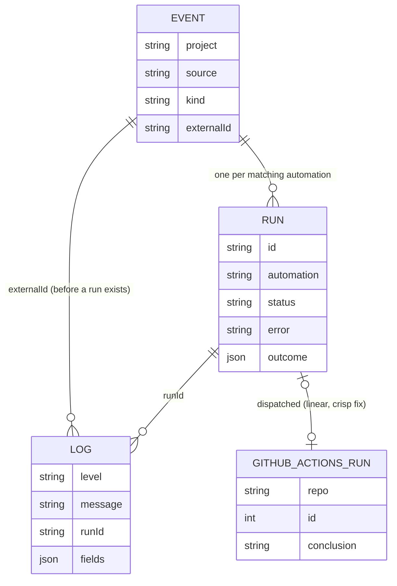
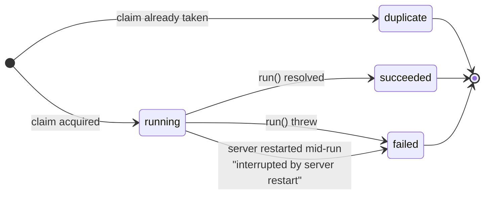
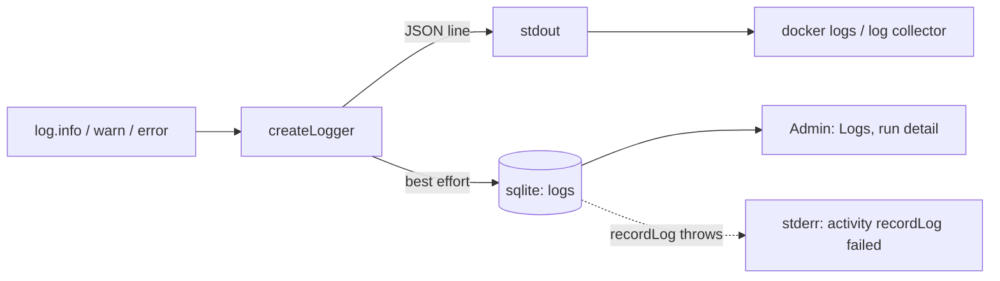
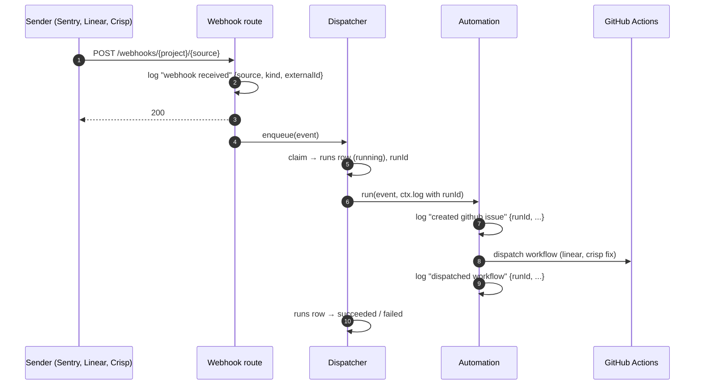

# Observability: logs and runs

Automations work in the background, after the sender has already got its `200`. Nobody watches them happen, so the server keeps a record of everything it does: every **run** of an automation or job, and every **log line** written along the way. Both are stored in sqlite, shown in the admin and written to stdout.

This page explains what is recorded, how to follow one event from the webhook to its result, and where to look when something goes wrong. What the server does about failures is described in [reliability.md](reliability.md).

- Code: `packages/core/src/activity.ts` (types), `packages/core/src/sqliteActivityStore.ts` (storage), `packages/core/src/logger.ts` (logger).
- Admin pages: Overview, Runs, Logs, Crisp, GitHub Actions (`apps/admin/src/routes/_authed`).
- API: `overview`, `runs.list`, `runs.get`, `logs.list` under `/rpc` (see [architecture.md](architecture.md#activity-store-and-admin-api)).

## Two records: runs and logs

| | Run | Log line |
| --- | --- | --- |
| What it is | One attempt of one automation (or job) on one event | One message written by the server, a source, an automation or a job |
| Answers | *Did it work?* | *What exactly happened, step by step?* |
| Table | `runs` | `logs` |
| Key fields | `id`, `project`, `automation`, `source`, `kind`, `externalId`, `status`, `startedAt`, `finishedAt`, `error`, `outcome` | `time`, `level`, `message`, `project`, `source`, `automation`, `externalId`, `runId`, `fields` |
| Admin page | Runs, run detail, Overview, Crisp | Logs, run detail |

One webhook can produce several runs: every automation whose `matches` accepts the event gets its own run. A webhook that no automation matches produces log lines and no run.

## Runs

### Statuses

| Status | Meaning | What to do |
| --- | --- | --- |
| `running` | The automation is working right now. | Nothing. A run that stays `running` across a restart becomes `failed`. |
| `succeeded` | `run()` finished without throwing. It may still have done nothing on purpose (a filtered Sentry level, an existing issue). The logs of the run say which. | Nothing. Open the run if the result is unexpected. |
| `failed` | `run()` threw. The message is in `error`. | Read `error` and the run's logs. See [what happens on a failure](reliability.md#what-happens-when-a-run-fails). |
| `duplicate` | The same event already has a claim for this automation, so it was skipped. | Usually nothing: the sender redelivered or the same trigger fired again. |

Scheduled jobs are recorded the same way, with `source = schedule`, `kind = job` and the occurrence key as `externalId` (for example `2026-W46` for the weekly PostHog report, or `manual:<timestamp>` for a run started from the admin).

`succeeded` means the server finished its part. For `linear-label-to-pr` and the `fix` decision of `crisp-triage` that part is *dispatching* a GitHub Actions workflow. Whether Codex then opened a pull request is shown on the GitHub Actions page, not in the run.

### Outcome

An automation can attach a structured `outcome` to its run with `ctx.report(...)`. It is stored as JSON next to the status and is kept for failed runs too, so a run that failed halfway still shows what it had already done. Today `crisp-triage` reports its decision, the model verdict, the GitHub issue, whether the workflow was dispatched and whether the note and the status segment were written back to Crisp. The Crisp page is built from these outcomes, and `runs.list` can filter on `outcome.decision`.

### Runs page

- Filters: status, automation, source, and a search over automation, external id and error text.
- Newest first, loaded in pages of 50.
- Each row opens the run detail: the run's fields, its `error`, its `outcome` and every log line that carries its `runId`, in order.

### Overview page

The Overview counts runs by status and log lines by level for the last 24 hours (up to 7 days), draws runs per hour as a chart (per 6 hours for windows longer than a day) and lists the latest failed runs. It is the page to open first: a spike of `failed`, or of `duplicate`, shows up here before anyone reads a log.

## Logs

### Where they go

Every log line is written twice:

1. To **stdout** as one JSON object per line: `{"time":"…","level":"info","message":"…", ...fields}`. This is what `docker logs` shows and what a log collector (Loki, Datadog, CloudWatch and so on) should pick up.
2. To the **`logs` table**, so the admin can search it without any external tooling.

The fields `project`, `source`, `automation`, `externalId` and `runId` are copied out of the JSON into indexed columns. Everything else stays in `fields`.

Writing to sqlite is best effort. If it fails, the error goes to stderr and the server keeps working. Stdout always gets the line.

### Levels

| Level | Used for |
| --- | --- |
| `info` | Normal progress: a webhook received, an issue created, a workflow dispatched, a duplicate skipped. |
| `warn` | Something unusual that did not fail the run: a rejected signature, an unparsable body, a description truncated for workflow inputs, a Crisp write refused by a free plan, enrichment failed and the original event was used. |
| `error` | A run or job failed, or a part of the machinery failed (claim, activity store, prune). |

### Correlation fields

Every line written inside a run carries `project`, `automation`, `externalId` and `runId`, added by the dispatcher or the scheduler, so an automation never has to add them by hand. Lines written before a run exists (the webhook route) carry `project`, `source`, `kind` and `externalId`.

To follow one event end to end:

1. Find the webhook: Logs, search the external id (a Sentry issue id, a Linear identifier, a Crisp session id).
2. Find the run: Runs, search the same external id. Open it to see every line with its `runId`.
3. If the run dispatched a workflow, open GitHub Actions in the admin and find the run of that workflow by time and inputs.

### Messages worth knowing

These come from the core and the webhook route, so they are the same for every integration. Automation-specific messages are listed on each [integration page](integrations).

| Message | Level | Meaning |
| --- | --- | --- |
| `server started` | info | Boot finished. Lists projects, automations and jobs that are registered. |
| `webhook received` | info | Signature valid, event parsed, `200` returned, work queued. |
| `webhook ignored` | info | Signature valid, but the payload is not something any automation handles (`reason` says why). |
| `webhook signature rejected` | warn | `401` returned. Usually a wrong or rotated secret. |
| `webhook parse failed` / `webhook body read failed` | warn | `400` returned. |
| `prepare failed, continuing with original event` | warn | Enrichment (for example Sentry event counts) failed. The automation runs on the unenriched event. |
| `matches threw` | error | An automation's `matches` threw. It is treated as no match for that automation only. |
| `duplicate skipped` | info | A `duplicate` run was recorded. |
| `automation failed` | error | A run failed. `error` holds the message. |
| `job failed` | error | A scheduled occurrence failed. |
| `claim failed` / `complete failed` / `release failed` | error | The claim store (sqlite) failed. See [reliability.md](reliability.md#when-the-machinery-itself-fails). |
| `activity <step> failed` | error | Writing a run to the activity store failed. The work went on, but the run may be missing or stuck in the admin. |
| `shutting down` / `shutdown complete` | info | Graceful shutdown started and ended. |

### Logs page

- Filters: level, source, automation, run id, and a search over message, external id and automation.
- **Live** switch: refreshes every 5 seconds, useful while sending a test webhook.
- A project's Logs page also shows server-wide lines (startup, reloads), which have no project.

## What is never logged

- Secrets: tokens, client secrets, API keys, the Slack webhook URL.
- Raw webhook bodies and full payloads.
- Customer text from Crisp is redacted (common secret shapes and the customer's email) before it goes to the model, a log line, a run outcome or a GitHub issue. Sentry content is redacted the same way before it is sent to GitHub.

When writing a new automation, log identifiers and decisions (`issueId`, `number`, `url`, `decision`), not payloads.

## Retention and storage

| Variable | Default | Description |
| --- | --- | --- |
| `DATABASE_PATH` | `./data/automation.db` | One sqlite file for claims, runs, logs and settings. Back it up as a whole. |
| `LOG_RETENTION_DAYS` | `30` | Logs, and runs that finished, older than this are deleted at startup and every hour. |

- Runs still `running` are never pruned. At startup they are marked `failed` with `interrupted by server restart`.
- Claims are not pruned. They are what keeps an event from running twice, see [reliability.md](reliability.md#claims-and-deduplication).
- Deleting a project keeps its runs and logs until retention removes them.

## Monitoring from outside

The admin is enough for a team that looks at it. To be paged instead:

- **Health:** `GET /health` returns `{"status":"ok"}` while the process serves requests. Point an uptime check at it.
- **Failures:** alert on stdout lines with `"level":"error"`, or specifically on `"message":"automation failed"` and `"message":"job failed"`, in your log collector.
- **Signature problems:** a run of `webhook signature rejected` after a deploy usually means a secret was not copied to the new environment.
- **API:** `overview` (with `ADMIN_API_TOKEN`) returns the same counters as the Overview page and can be polled by a script.
