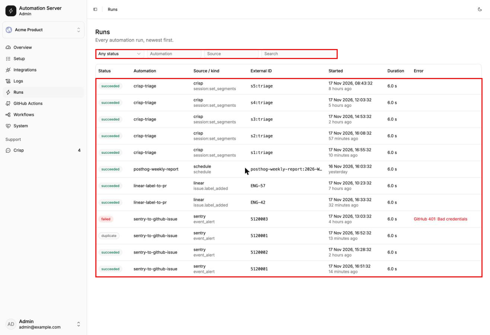
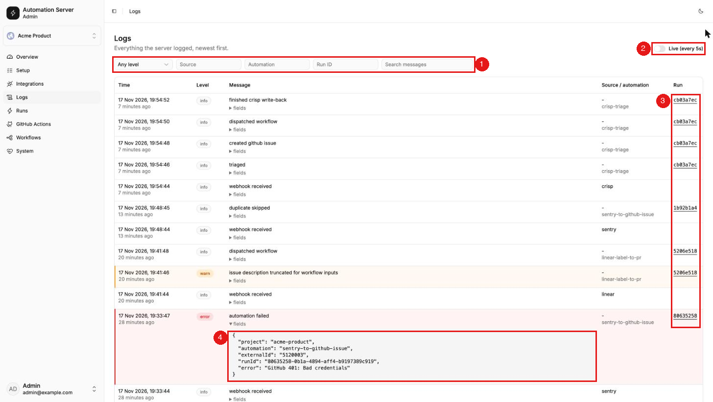

# Observability: runs, logs and results

Automations work in the background, after the sender has already got its `200`. To show what they did, the server records every **run** (one automation handling one event) and every **log line**, and shows both in the admin. To show how it ended, it also follows the issues, workflow runs and PRs a run led to, and what its LLM calls cost. What the server does when a run fails is in [reliability.md](reliability.md).

## Runs

Each row is one automation handling one event. A webhook that two automations match gives two rows. Scheduled jobs show here too, with source `schedule` and the week (`2026-W46`) as the external id. Click a row to open the run: its error, its result and all of its log lines in order.

| Status | Meaning |
| --- | --- |
| `running` | Working right now. If the server restarts during the run, it becomes `failed` with `interrupted by server restart`. |
| `succeeded` | Finished without an error. It may have done nothing on purpose, for example a filtered Sentry level or an issue that already exists. The run's log lines say which. |
| `failed` | Threw an error. The message is in the Error column. It usually names what to fix: a token, a permission, a missing workflow. |
| `duplicate` | The event was already handled by this automation, so it was skipped. This is normal when a sender redelivers. |

For `linear-label-to-pr` and the Crisp `fix` decision, `succeeded` means only that the GitHub workflow was started. What happened next shows in the run's **Result** card, described in [What a run led to](#what-a-run-led-to).

The **Overview** page sums this up for the last 24 hours or 7 days: counts by status, a chart of runs and the latest failures. Open it first.

## What a run led to

A run's page has a **Result** card above the Timeline. It follows the run's work through GitHub:

`Sentry issue 4711` → `GitHub issue #123` → `workflow run #88 (success)` → `PR #130 (merged in 6 h)`

- The first node is what started the run. For a Sentry alert it links to the Sentry issue while the run is retained.
- Then one block per work item the run touched: the GitHub or Linear issue, the dispatches, every workflow run that worked on it (newest first) and the PRs it produced. A run that created the issue says so; a run that dispatched work on an existing issue says that instead.
- **No workflow run appeared for this dispatch** means the dispatch is more than 30 minutes old and no run carries its work item. GitHub keeps one pending run per `codex-auth` queue, so a newer dispatch can replace a queued one. Rerun it from the Actions tab.
- **As of** is the time of the last GitHub sync. **Refresh** syncs now.
- An **LLM usage** row lists the run's model calls with tokens and cost.

The card is hidden for runs that touched no work item and made no LLM call, such as the PostHog report.

### How a workflow run is tied to a work item

Every link rests on evidence. A run with none stays unlinked, because a wrong link is worse than a missing one.

| Match | Evidence |
| --- | --- |
| `exact` | GitHub answered our dispatch with the id of the run it started. |
| `titled` | The run's name carries the work item: `Codex issue fix #123` or `Linear implement ENG-42`. The templates set this name; installs from before it need a reinstall. |
| `linked` | The PR the run opened ends with `Run log: <run URL>`. |

A PR is tied to its work item by its branch (`codex/issue-123`, `linear/eng-42`), then by the `ENG-42:` prefix of a Linear PR's title. That is why a fix started by hand for a Sentry issue still shows on the Sentry run. An issue reference in the description such as `Closes #42` ties nothing: a changelog or SEO PR that quotes one did not do that issue's work.

## Codex PR outcomes

The **Outcomes** page answers whether the fixes Codex opens get merged. It shows the last 30 or 90 days.

- **Opened**, **Merged** and **Closed** count the PRs opened, merged and closed without merge in the window. A PR opened before the window and merged inside it counts as merged.
- **Open** is every Codex PR open right now, whatever its age.
- **Useful rate** is merged divided by merged plus closed. Open PRs stay out of it, so fresh work does not lower it.
- **Median time to merge** runs from the PR being opened to it being merged, draft time included.
- **By origin** credits each PR to the first automation that touched its work item (`crisp-triage`, `linear-label-to-pr`, `sentry-to-github-issue`, `slack-bot`). PRs with no automation in front are credited to their workflow: `codex-issue-fix` for issues people opened, `codex-seo-autopilot`, `codex-changelog`.

A Codex PR is one on a branch a Codex workflow pushes: `codex/issue-*`, `linear/*`, `seo-autopilot/*` or `changelog/*`. Other PRs are never stored.

The server reads the PRs and workflow runs with the GitHub token, so there is nothing to set up. The `outcome-sync` job runs every hour, and the first sync reads 90 days back. It covers the Actions repositories and the Linear target repository. A repository the token cannot read shows its error on the Outcomes page while the others sync. The token needs Pull requests: Read and Actions: Read on each. **Sync now** runs the job at once, and every sync shows on the Runs page with source `schedule`.

## LLM cost

Every LLM call the server makes through OpenRouter is recorded with its model, tokens and the price OpenRouter reports. The **Costs** page shows one calendar month (UTC):

- Spend against the monthly budget, a projection to the end of the month, and the budget alerts already sent.
- Daily spend, spend by automation and by model, and the costliest runs.
- Calls made outside any run, such as a connection test, appear as their own row.
- A call that came back without a price is counted, shown as unpriced and left out of the total. It is never counted as free.

Codex itself bills through the ChatGPT account in `CODEX_AUTH_JSON`, not through OpenRouter, so its cost is not here.

The monthly budget is the OpenRouter **Monthly budget (USD)** setting. When spend reaches 80% and again at 100%, the Slack alerts webhook gets one message for each, once a month:

`:moneybag: LLM spend for project default reached 80% of the $50.00 monthly budget ($40.12 in 2026-11)`

The budget only alerts. The credit limit on the OpenRouter key is the hard cap, see [OpenRouter setup](setup/openrouter.md#4-add-credit-and-set-limits). Raising the budget during a month does not send an alert again for a threshold already reached that month.

## Logs

1. **Filters:** level, source, automation, run id, and a search over message, external id and automation.
2. **Live** refreshes the list every 5 seconds. Turn it on while you send a test webhook.
3. **Run:** every line written during a run carries its `runId`. Click it to open the run.
4. **Fields:** the structured data of the line. Here an `automation failed` line shows the error.

A line looks like `{"time", "level", "message", ...fields}`. Every line written during a run gets `project`, `automation`, `externalId` and `runId` automatically. Lines from the webhook route (`webhook received`) carry `source`, `kind` and `externalId`.

### Following one event

1. **Logs**: search for the external id (a Sentry issue id, a Linear identifier like `ENG-42`, a Crisp session id). You get `webhook received` and the lines of every run it started.
2. **Run**: click the run id to see the status, the error and the lines of that run.
3. **Result**: if the run created an issue or started a workflow, its Result card shows the workflow runs and PRs that followed.

### Messages to know

| Message | Level | Meaning |
| --- | --- | --- |
| `webhook received` | info | Signature valid, `200` sent, work queued. |
| `webhook ignored` | info | Valid, but nothing handles this kind of payload. `reason` says why. |
| `webhook signature rejected` | warn | `401` sent. Usually a wrong or rotated secret. |
| `duplicate skipped` | info | The event was already handled. |
| `prepare failed, continuing with original event` | warn | Enrichment failed (for example the Sentry event count). The run used the event without it. |
| `automation failed` / `job failed` | error | A run failed. `error` holds the reason. |
| `claim failed`, `activity … failed` | error | sqlite itself failed. See [reliability.md](reliability.md#when-the-machinery-itself-fails). |

Each automation's own messages (`created github issue`, `dispatched workflow`, `triaged` and so on) are on its [integration page](integrations).

## Where it is stored

- Every line goes to **stdout** as JSON, which is what `docker logs` and a log collector see. It also goes to the `logs` table in sqlite, which the admin reads. If the sqlite write fails, the stdout line is still written.
- Runs and logs live in the same file as everything else (`DATABASE_PATH`). They are deleted after `LOG_RETENTION_DAYS` (default `30`), checked at startup and every hour.
- LLM calls, Codex PRs, workflow runs and run chains are kept for `LEDGER_RETENTION_DAYS` (default `400`), so a month can be compared with the same month a year earlier. A PR that is still open is kept however old it is. Once a run itself is pruned, its PRs still count for its automation, and the PR's **Run** link opens a page saying the run was pruned.
- Dispatch inputs are never stored. The server keeps only the work item they name (`gh:acme/app#123`, `linear:ENG-42`) and a Linear issue link.
- Secrets and raw webhook payloads are never logged. Crisp and Sentry text is redacted (tokens, the customer's email) before it reaches a log line or a GitHub issue. When you write an automation, log ids and decisions, not payloads.

## Alerts outside the admin

- **Uptime:** `GET /health` returns `{"status":"ok"}`.
- **Failures:** alert on stdout lines with `"message":"automation failed"` or `"message":"job failed"`.
- **Secrets after a deploy:** a burst of `webhook signature rejected` means a secret did not reach the new environment.
- **Polling:** the `overview` API (with `ADMIN_API_TOKEN`) returns the same counts as the Overview page.
