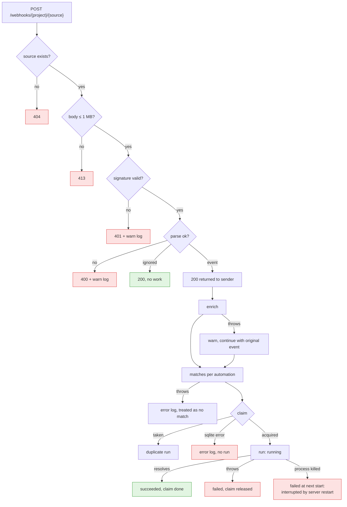
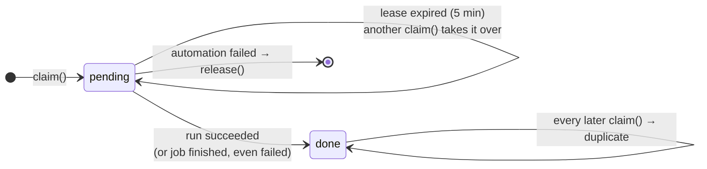
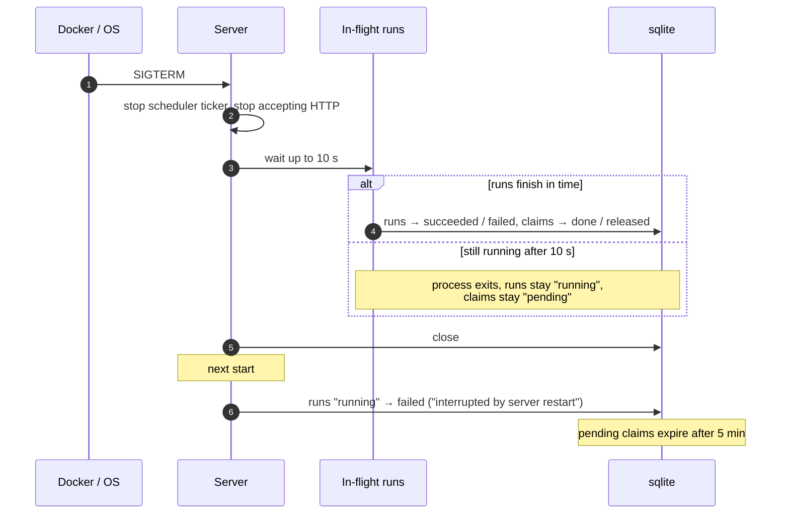
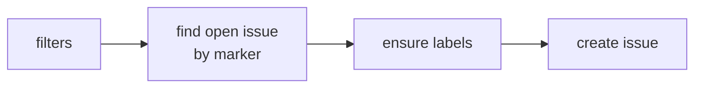
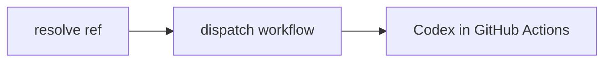
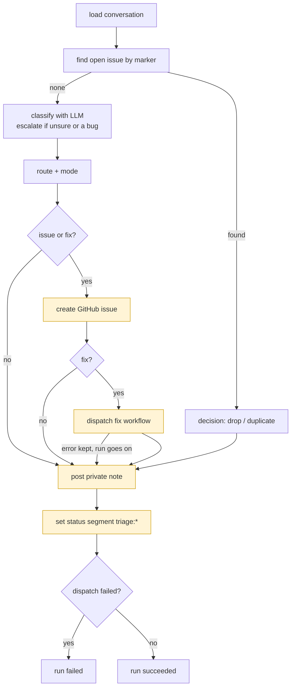
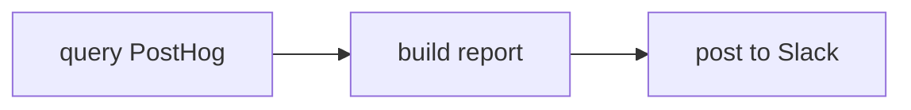

# Reliability: failures, retries and partial runs

An automation calls several outside services in a row: an LLM, GitHub, Crisp, Slack. Any of them can be down, slow or refuse a token, and the server itself can be restarted in the middle of a run. This page explains what the server guarantees, what it does not, and what is left behind when a run stops halfway.

How to *see* all of this (runs, logs, statuses) is described in [observability.md](observability.md).

- Code: `packages/core/src/dispatcher.ts`, `packages/core/src/scheduler.ts`, `packages/core/src/sqliteStore.ts`.
- Tests: `packages/core/test/dispatcher.test.ts`, `packages/core/test/scheduler.test.ts`, `packages/core/test/sqliteStore.test.ts`.

## The short version

- **At most once per event, per automation.** A claim in sqlite keeps the same event from being handled twice, also across restarts and redeliveries.
- **No automatic retries.** A failed run is recorded as `failed` and stays failed. The server never calls a service again on its own.
- **A failed webhook run can be retried by triggering the event again.** Its claim is released, so the next delivery of the same event runs. A successful run keeps its claim forever.
- **A failed scheduled job keeps its claim** and is not retried by the ticker. Run it by hand from the admin.
- **Nothing is rolled back.** What a run already created (an issue, a dispatched workflow, a note) stays. Each automation is written so that running it again finds that work instead of repeating it, where the outside service allows it.
- **Senders do not retry.** The server answers `200` before the work starts, so Sentry, Linear and Crisp consider the delivery done even if the run later fails.

## Where a failure can happen

Everything above the `200` is synchronous, and the sender sees the error code. Sentry, Linear and Crisp each have their own retry policy for non-2xx answers. Everything below the `200` happens in the background, and the sender never learns about it.

## Claims and deduplication

Before a run starts, the dispatcher claims the key `<project>/<automation>:<externalId>` in the `claims` table. The scheduler does the same with `<project>/<job>:<occurrence key>`. The external id is chosen by each source so that "the same event" maps to the same key:

| Automation | External id | So that |
| --- | --- | --- |
| `sentry-to-github-issue` | Sentry issue id | Every alert of one Sentry issue maps to one run. |
| `linear-label-to-pr` | issue id, added label ids and `updatedAt` | A redelivery is skipped, but removing and adding the label again is a new run. |
| `crisp-triage` | `<sessionId>:triage` (segment added) or `<sessionId>:resolved` | One triage per conversation. |
| `posthog-weekly-report` | ISO week, for example `2026-W46`, or `manual:<timestamp>` | One report per week. A manual send never collides with the weekly one. |

A claim is `pending` while the run works and moves to `done` or is deleted when it ends:

- **`done` is permanent.** Claims are never pruned. A Sentry issue that already produced a GitHub issue will not produce another, even if that GitHub issue is closed and the error comes back. Create the issue by hand in that case.
- **`release` on failure.** A webhook run that throws deletes its claim, so the next delivery of the same event is a fresh run, not a duplicate.
- **5-minute lease.** A `pending` claim older than 5 minutes can be taken over. This is what frees the claim of a run that never finished because the process was killed. It also means a run that takes longer than 5 minutes can, in theory, run twice if the same event arrives again in the meantime. No current automation comes close: the slowest step is an OpenRouter call with a 90-second timeout.

## What happens when a run fails

### Webhook automations

1. The automation throws. The error message is stored on the run, and `automation failed` is logged with its `runId`.
2. The claim is released.
3. Whatever the run did before the error stays done. There is no rollback.
4. The sender already got `200` and will not redeliver on its own.

To retry, fix the cause (usually a token or a missing workflow, the error message says which), then trigger the same event again in the source service. Because of step 3, the retry may meet the work of the first attempt. Each automation handles that as described in [partial runs](#partial-runs-by-automation).

### Scheduled jobs

1. The job throws. The run is `failed`, `job failed` is logged.
2. The claim is kept (`done`), so the ticker does not call a broken integration every minute for the rest of the week.
3. To retry, use **Send now** on the PostHog integration page. It runs the job under a new key `manual:<timestamp>`, records it as a normal run and returns its status.

A job never runs twice at the same time: while one occurrence of a job is running in a project, the ticker and **Send now** answer `busy`.

### Timeouts

Calls that can hang have a timeout, and a timeout fails the run like any other error:

| Call | Timeout |
| --- | --- |
| OpenRouter (Crisp triage) | 90 s per model call |
| PostHog HogQL query | 30 s |
| Slack incoming webhook | 15 s |
| Crisp REST API | 10 s |
| Sentry API (enrichment) | 3 s, then the event goes on without the extra data |

## Restarts and shutdown

- A run cut off by a restart is shown as `failed` with `interrupted by server restart`. It may have done part of its work.
- Its claim stays `pending` for up to 5 minutes, then the same event can run again. For webhooks that means triggering it again. For the weekly job it means the next tick in the same week runs it again, which can post the report twice if the restart happened right after the Slack post.
- Webhooks that arrive while the server is down get a connection error, which the sender may retry by its own policy.
- A settings change rebuilds the integrations without a restart. Runs already in flight finish with the settings they started with.

## Partial runs by automation

What each automation does, in order, and what is left behind if it stops at that step.

### `sentry-to-github-issue`

| Fails at | Left behind | Retry |
| --- | --- | --- |
| Filters, search, labels | Nothing (labels may exist, harmless). | Safe. |
| Create issue | Nothing, unless GitHub created it and the response was lost. | Safe. The marker search finds an issue that was created, so there is never a second one. |

### `linear-label-to-pr`

| Fails at | Left behind | Retry |
| --- | --- | --- |
| Resolve ref, dispatch | Nothing. The error says what to fix (workflow missing, no `workflow_dispatch`, token scope). | Remove and add the label again. |
| The workflow itself | The run is `succeeded`: the server's part, the dispatch, worked. The failure is on the GitHub Actions page. | Re-run the workflow in GitHub, or remove and add the label. |

All Codex workflows share the concurrency group `codex-auth` with `cancel-in-progress: false`. GitHub keeps one running and one pending run per group, so in a burst a queued dispatch can be replaced by a newer one. The server cannot see that. Check GitHub Actions when several tasks are labelled at once.

### `crisp-triage`

The automation with the most steps, and the only one that keeps going after some failures to write back what it knows.

Yellow steps write to an outside service.

| Fails at | Left behind | Retry |
| --- | --- | --- |
| Load conversation, LLM, routing | Nothing written. | Remove and re-add the trigger segment. |
| Create issue | Nothing in Crisp. | Same. |
| Dispatch fix workflow | The issue exists. The note says the fix could not be started, the status segment is set, and *then* the run fails with the dispatch error. | Start `codex-issue-fix.yml` by hand for that issue. A re-triage would find the issue and drop the conversation as a duplicate. |
| Post note / set segment (other than `402`) | The issue and the dispatch, if any. | Remove any `triage:*` segment and re-add the trigger segment. The retry finds the issue and drops the conversation as a duplicate, and the note says so. |
| Crisp answers `402` (free plan) | Not a failure. The run succeeds, the note is written to the run's log instead, and the outcome records `notePosted: false` / `segmentSet: false`. | Nothing to retry. |

The run's `outcome` is reported before the Crisp writes and again after them, so a failed run still shows the decision, the issue and the dispatch result on the Crisp page.

### `posthog-weekly-report`

| Fails at | Left behind | Retry |
| --- | --- | --- |
| Query, build | Nothing. | **Send now** in the admin. |
| Post to Slack | Nothing, unless Slack accepted it and the response was lost. | **Send now**. In the rare lost-response case the report appears twice. |

## When the machinery itself fails

| What fails | Effect | Log |
| --- | --- | --- |
| Claim store (sqlite) on `claim` | The run does not start and is not recorded. | `claim failed` |
| Claim store on `complete` | The run is recorded as succeeded, but its claim stays `pending` and can be taken over after 5 minutes. | `complete failed` |
| Claim store on `release` | The failed run's claim stays `pending` for 5 minutes, so an immediate retry is a `duplicate`. | `release failed` |
| Activity store | Work goes on. The run may be missing in the admin or stuck at `running` until the next restart. | `activity <step> failed` |
| Enrichment | The automation gets the event without the extra data (for example no Sentry event count, so the count filter is skipped). | `prepare failed, continuing with original event` |
| An automation's `matches` | Only that automation skips the event. | `matches threw` |
| An integration module at build time | The integration is not registered. The others keep working. | `integration build failed, skipped` |

All of these share one sqlite file. A full disk or a read-only volume shows up as many of them at once.

## Writing a reliable automation

Rules the existing automations follow, for anyone [adding an integration](adding-an-integration.md):

- **Throw to fail.** Do not catch an error just to log it: a run that swallows its error is recorded as `succeeded` and its claim is never released.
- **Make the first side effect findable.** Before creating something, look it up by a marker you put in it (`Sentry Issue: <id>`, the Crisp session marker). That is what makes a retry after a partial run safe.
- **Order steps from cheap and safe to expensive and visible.** Classify before writing, create before dispatching.
- **Report progress.** Call `ctx.report(outcome)` after each meaningful step, so a failed run still shows what it did.
- **Turn API errors into instructions.** `linear-label-to-pr` and `crisp-triage` map GitHub `401`, `403`, `404` and `422` to a message that names the missing permission or workflow. That message is what the team reads on the Runs page.
- **Put a timeout on every outside call** (`AbortSignal.timeout`).
- **Decide which failures are not failures.** A plan limit (`402` from Crisp) or a filtered event should log and return, not throw.
