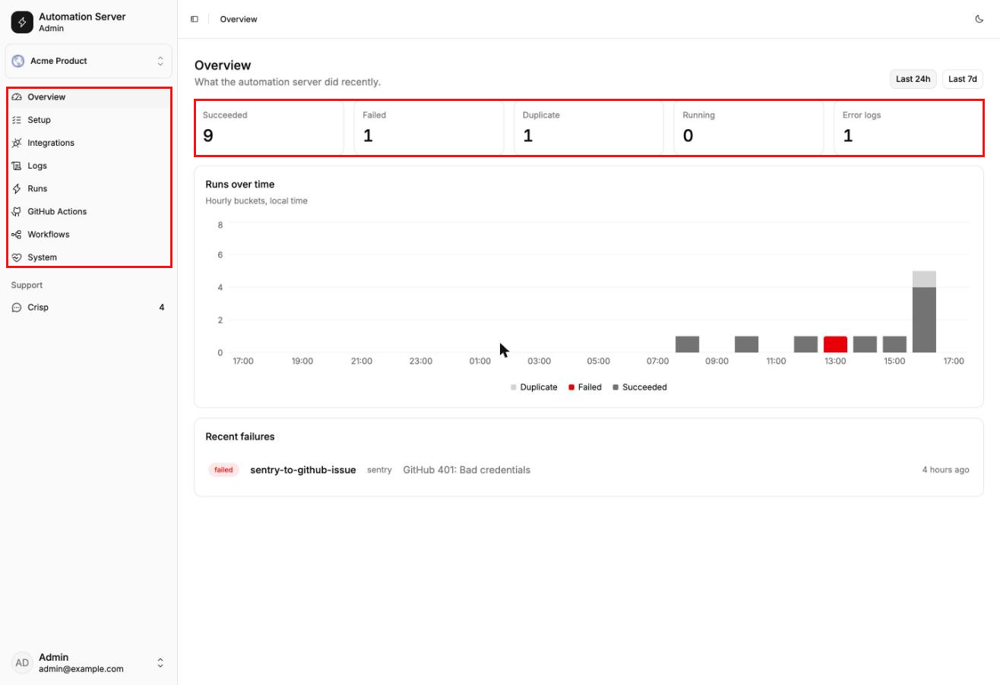
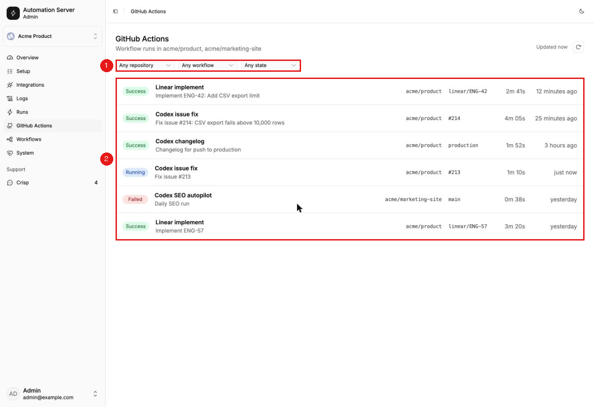
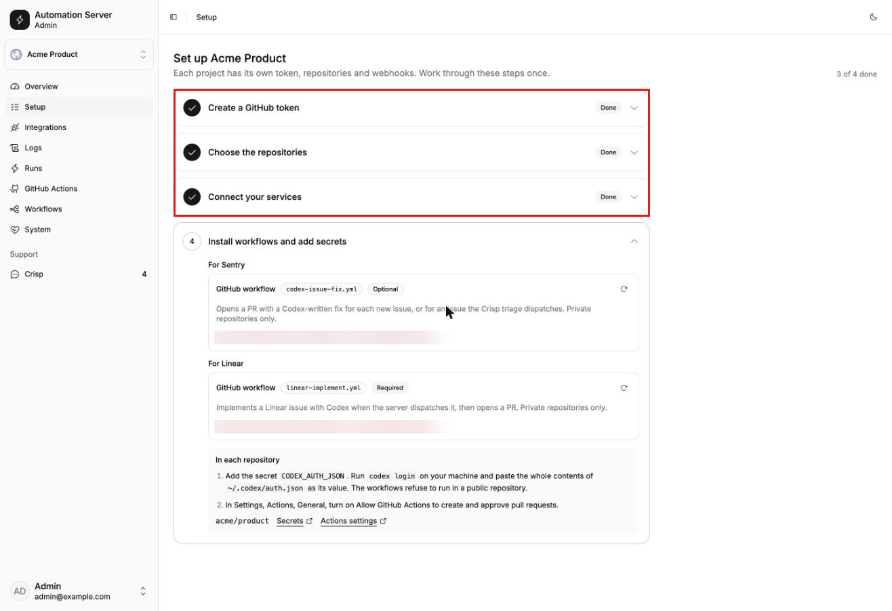
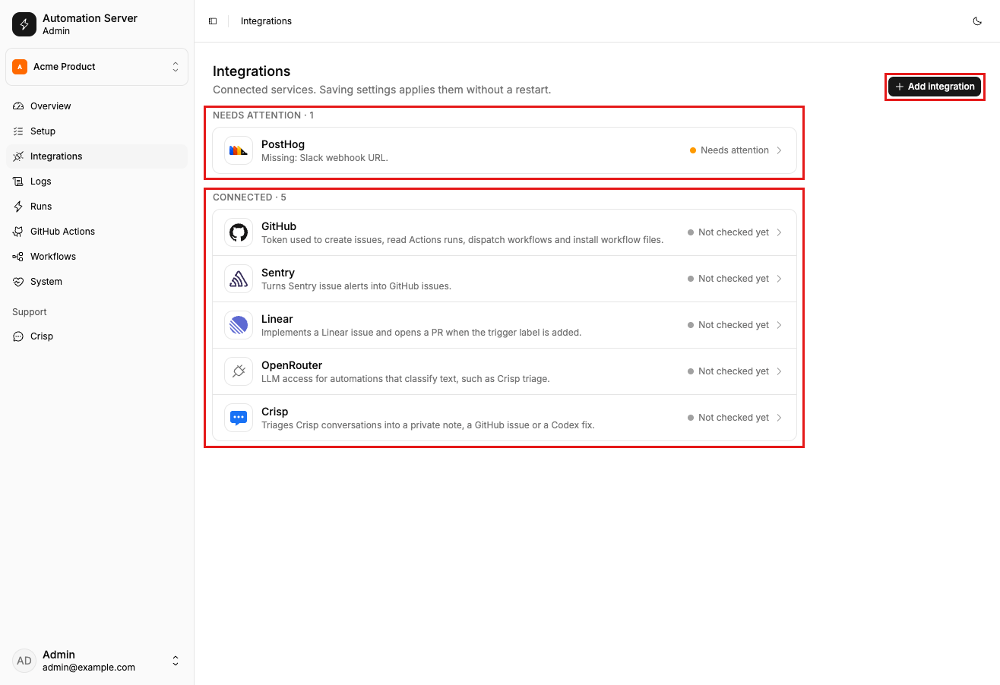

# Setup guides

Step-by-step guides for connecting each service to automation-server. Every guide says what to open, what to click, what to copy, and which field in the admin Integrations page (or which environment variable) receives the value. Screenshots carry a red underline or box on the element that matters.

These guides cover setup only. For what each integration does once it runs, read [docs/integrations](../integrations).

## What this tool is

automation-server is a small server you host yourself. It sits between the tools your team already uses and does the routine work that follows an event in one of them. Examples:

- A new error appears in **Sentry**. The server opens a GitHub issue for it, and Codex can propose a fix as a pull request.
- Someone adds the label `codex` to a **Linear** task. Codex implements it and opens a pull request that Linear attaches to the task.
- A support person tags a **Crisp** conversation with `triage`. An AI model classifies it (bug, feature request, how-to question, spam), writes a note back into the conversation and, if it is a bug, opens a GitHub issue or starts a fix.
- Every Monday a short **PostHog** report with last week's numbers lands in a **Slack** channel.

You do not write code to get these. You deploy the server, open its **admin** in a browser, paste a few tokens from each service, and the automations switch on. Nothing is merged or sent to a customer without a person: the results are issues, draft pull requests, private notes and Slack messages.

```
Sentry, Linear, Crisp   --webhook-->   automation-server   --API-->   GitHub issues, GitHub Actions (Codex), Crisp notes
PostHog                 <--query----   (runs on a schedule) --post-->  Slack
                                              ^
                                       you configure it in the admin
```

## The admin at a glance

The admin is the only screen you need. Sign in with the email and password from your deployment, and pick the project in the top left (one server can host several projects, each with its own tokens).



| Page | What it is for |
| --- | --- |
| **Overview** | Counters for the last day or week: runs that succeeded, failed or were duplicates, a chart over time and the latest failures. Open it first when something seems off. |
| **Setup** | A checklist for a new project: GitHub token, repositories, services, workflows. |
| **Integrations** | One card per service. This is where every token and setting from these guides goes. |
| **Logs**, **Runs** | Everything the server did. A run is one automation reacting to one event. |
| **GitHub Actions** | Live status of the Codex workflow runs in your repositories, with jobs and steps. |
| **Workflows** | Installs the bundled GitHub Actions workflows into a repository. |
| **System** | Uptime, which sources and automations are active. |
| **Crisp** | Appears under **Support** once Crisp is added. The triaged conversations. |

The **GitHub Actions** page lists runs of the Codex workflows with their status, so you can follow a fix or an implementation while it works.



The **Setup** page walks through the order below inside the admin itself, and ticks each step as you finish it.



### Where the values from these guides go

Open **Integrations**. Each service you can use has a card. A card says **Configured** once its required fields are filled. Click **Configure** to open its form.



All forms work the same way:

- **Webhook URL** (Sentry, Linear, Crisp). A read-only field with a copy button. You paste it into the other service. It needs `PUBLIC_URL` on the server to show the full address.
- **Secret fields** (tokens, signing secrets). An empty one is an input box. Once saved it shows **Set** and the value is never displayed again. Click **Replace**, paste the new value, then **Save**. **Clear** removes it. Secrets are stored encrypted and need `SETTINGS_ENCRYPTION_KEY` on the server.
- **Plain fields** (repository, label, model). Type the value and click **Save**. Saving applies at once, no restart.
- **Test connection** (GitHub, Linear, PostHog, OpenRouter, Crisp, Slack). Checks the saved values against the real service. Run it after every save.

Each guide below shows the exact form with the fields numbered in the order you fill them.

## What each automation does

Each integration adds an **automation**, a small job with one purpose. This is what they do and what they need.

| Automation | Trigger | What happens | Result you see | Needs |
| --- | --- | --- | --- | --- |
| `sentry-to-github-issue` | A Sentry issue alert fires | The server checks the alert (signature, level, environment), makes sure the issue is not already open, and creates a GitHub issue with the error, stack trace, breadcrumbs and a link back to Sentry. Secrets are scrubbed first. | A GitHub issue labelled `sentry`. With `codex-issue-fix.yml` installed, start the fix from the Actions tab to get a draft PR. | GitHub, Sentry |
| `linear-label-to-pr` | The trigger label is added to a Linear issue | The server dispatches the `linear-implement` workflow with the issue title and description. Codex implements it in the target repository. | A pull request titled with the issue identifier, attached to the Linear issue. | GitHub, Linear |
| `crisp-triage` | The trigger segment is added to a Crisp conversation | The server reads the conversation, strips personal data, asks an AI model (through OpenRouter) to classify it, and routes by a fixed table. It writes a private note and a `triage:` segment back into Crisp. In `issue` mode it also opens a GitHub issue, in `fix` mode it starts Codex too. The customer never gets a message. | A row on the admin Crisp page, a private note in Crisp, optionally a GitHub issue or a draft PR. | GitHub, OpenRouter, Crisp |
| `slack-bot` | Someone tags the bot in Slack | The server checks the member against the allowlist and replies in the thread. This version only repeats the message back. | A threaded reply in Slack and a run on the Runs page. | Slack bot settings |
| `posthog-weekly-report` | A schedule: one day and hour per week | The server asks PostHog for this week and last week, compares users, pageviews, sessions, top pages and top events, and posts the result to Slack. | A Slack message every week. Also **Preview report** and **Send now** buttons in the admin. | PostHog, Slack |

The code-writing part is done by four GitHub Actions workflows. The server only dispatches them. They are explained one by one, with what each does and needs, in [github-actions/README.md](../../github-actions/README.md#the-workflows-one-by-one).

For the exact rules of each automation (filters, deduplication, retries, limits), read its page in [docs/integrations](../integrations). How to follow a run in the admin is in [observability.md](../observability.md), and what happens when one fails or stops halfway is in [reliability.md](../reliability.md).

## Where to start

1. Deploy the server and the admin first. See [docs/deployment.md](../deployment.md). Every webhook below needs a public HTTPS URL, so set `PUBLIC_URL`.
2. Sign in to the admin. Each service has a card on the Integrations page. Values saved there take effect without a restart and secrets are stored encrypted (this needs `SETTINGS_ENCRYPTION_KEY`).
3. Connect services in this order, since later ones reuse earlier ones.

| Order | Guide | You create | You paste into the admin |
| --- | --- | --- | --- |
| 1 | [GitHub](github.md) | Fine-grained token, repository secrets | GitHub token, repository |
| 2 | [OpenRouter](openrouter.md) | API key, credit limit | OpenRouter API key, models |
| 3 | [Sentry](sentry.md) | Internal integration, issue alert | Client secret |
| 4 | [Linear](linear.md) | Webhook, trigger label | Signing secret, trigger label, target repository |
| 5 | [Crisp](crisp.md) | Marketplace plugin, Web Hooks, `triage` segment | Plugin credentials, website ID, signing secret |
| 6 | [PostHog](posthog.md) | Personal API key, Slack webhook | Project ID, API key, Slack webhook URL |
| 7 | [Slack alerts](slack.md) | Slack incoming webhook | Webhook URL, failure threshold |
| 8 | [Slack bot](slack-bot.md) | Slack app, bot token, signing secret | Bot token, signing secret, allowed member IDs |

## Which service needs which

| Integration | Needs GitHub | Needs OpenRouter |
| --- | --- | --- |
| Sentry to GitHub issue | yes | no |
| Linear label to PR | yes | no |
| Crisp triage | yes | yes |
| PostHog weekly report | no | no |
| Slack alerts | no | no |
| Slack bot | no | no |

## Conventions in these guides

- `<your-host>` is your public server URL. `<project>` is the project slug from the admin (`default` unless you changed it).
- Placeholders such as `ghp_xxx` stand for secrets. Never commit a real one.
- A red underline or box marks the element to use. A red label gives the step number.
- Third-party UIs change. If a screenshot no longer matches, trust the text and the field names, then send a fix for the image.

## Updating screenshots

Annotate a new capture with the shared script. It underlines, boxes, labels, crops and blurs.

```bash
python3 scripts/annotate-screenshot.py raw.png docs/setup/img/<service>-NN-<slug>.png spec.json
```

The spec format is in the script's docstring. Blur every email, name, token and customer message before committing an image.
