# Set up Crisp

This guide connects Crisp to automation-server. An operator adds a segment to a Crisp conversation. The server classifies the conversation, posts a private note, and by mode opens a GitHub issue or starts the Codex fix workflow. The customer never gets a message from the server.

For what the integration does once it runs, see [docs/integrations/crisp.md](../integrations/crisp.md).

The Crisp settings live in the admin Integrations page. No environment variables are involved.

## What you need

- A Crisp workspace where you are an owner or admin.
- A Crisp Marketplace developer account at https://marketplace.crisp.chat. It uses your Crisp login.
- The public host of your server and your project id. The webhook URL is `https://<host>/webhooks/<project>/crisp`. The project is `default` unless you run several.
- The admin app of this project, open on its Integrations page.
- The OpenRouter integration for the LLM, see [Set up OpenRouter](openrouter.md). Modes `issue` and `fix` also need GitHub, see [Set up GitHub](github.md).

The screenshots show the Crisp app in English. If your Crisp is in another language, switch it under **Settings**, **Account**, **Interface**, **Language**. Secrets and ids in the images are blurred.

## What you will set

| Where in the admin, Integrations, Crisp | Value | Comes from |
| --- | --- | --- |
| **Website ID** | Id of your Crisp website | Crisp settings (step 6) |
| **Plugin token identifier** | Identifier of the production token | Marketplace, Tokens (step 3) |
| **Plugin token key** | Key of the production token | Marketplace, Tokens (step 3) |
| **Web Hooks signing secret** | Signing secret of the plugin | Marketplace, Tokens (step 3) |
| **Trigger segment** | Segment name, default `triage` | Crisp inbox (step 8) |
| **Mode** | `shadow`, `issue`, `fix` or `dry-run` | Your choice (step 9) |

## 1. Create the plugin

1. Open https://marketplace.crisp.chat and sign in. The Plugins page lists your plugins.
2. Click **New Plugin**. Give it a name such as `automation-server triage`. Keep it private. The plugin is only a container for a token and a web hook, so you do not need a listing.
3. Click the new plugin to open it.

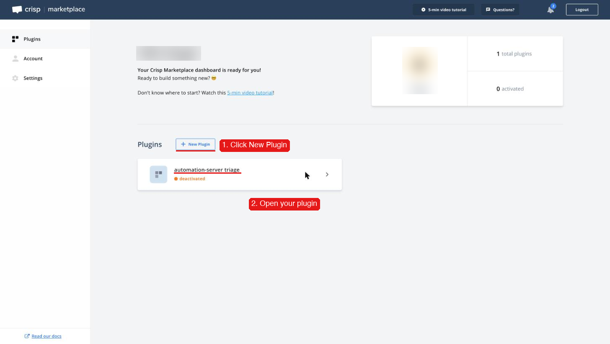

The plugin page has four tabs. **Tokens** holds the key and the scopes. **Settings** holds the Web Hooks.

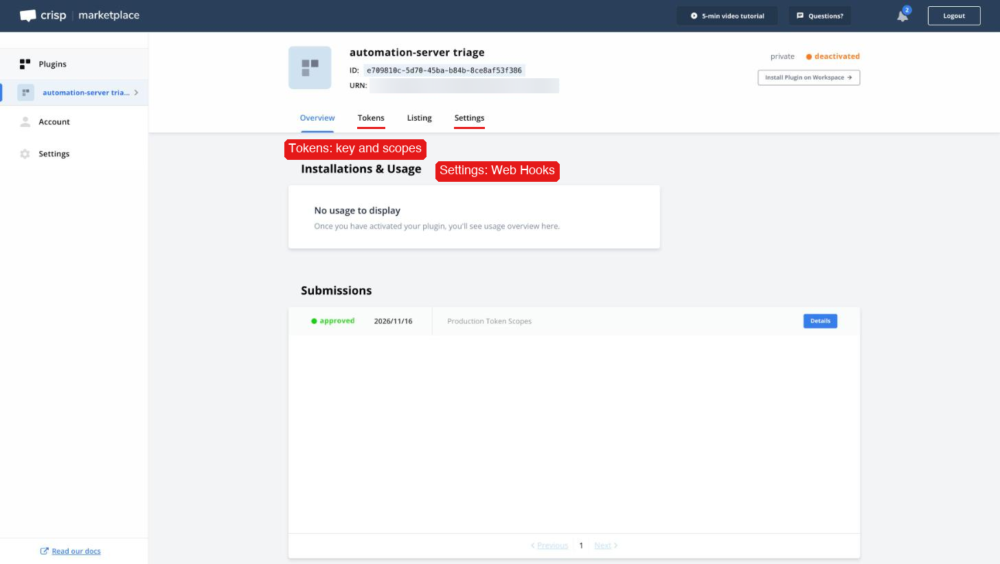

## 2. Understand the two tokens

The Tokens tab shows a Development Token on top and a Production Token below it. The development token has every scope but a limit of 500 requests per 24 hours. The production token has the scopes you pick and a limit of 5000 requests per day.

Use the production token. It only works once the plugin is activated (step 5). Crisp reviews the scope list the first time you change it. The Overview page shows the result under Submissions.

## 3. Pick the scopes and copy the token

1. Open the **Tokens** tab and scroll to the Production Token.
2. Under **Scopes**, click **Add a Scope** and add both namespaces below. Tick read and write on each.

| Namespace | Access | Used for |
| --- | --- | --- |
| `website:conversation:sessions` | read, write | Read the conversation and its segments. Write the `triage:` status segment. |
| `website:conversation:messages` | read, write | Read the messages. Write the private note. |

3. Click **Update production token** and wait for the scope submission to show as approved on the Overview tab.

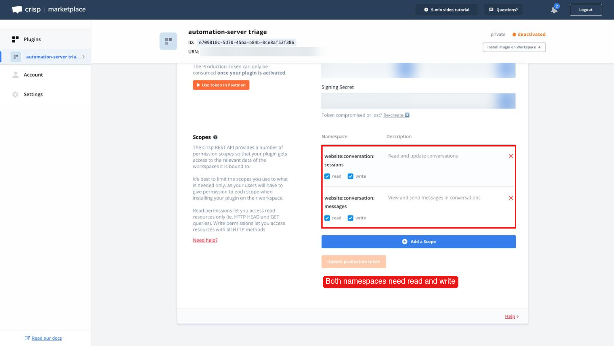

4. In the Token block, click the copy button next to **Identifier** and paste it into the admin field **Plugin token identifier**.
5. Copy **Key** into **Plugin token key**.
6. Copy **Signing Secret** into **Web Hooks signing secret**. This is the secret Crisp uses to sign every delivery. The server checks it on each request.

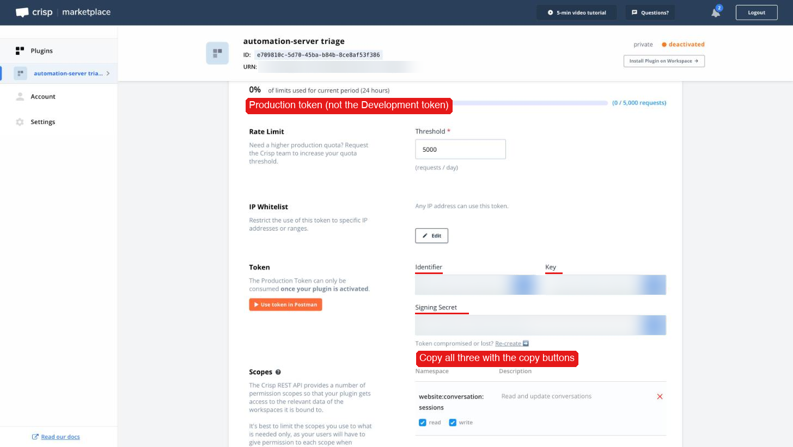

Never paste these values into a chat, an issue or a commit. If one leaks, click **Re-create** under the Signing Secret and update the admin.

## 4. Add the web hook

1. Open the **Settings** tab and scroll to **Events**, **Web Hooks**.
2. In **Production Web Hook**, enter `https://<host>/webhooks/<project>/crisp`. The admin shows the exact URL on the Crisp integration page, with a copy button.
3. Click **Create Web Hook**.
4. In the dialog that lists events, turn on exactly these two and leave the rest off.

| Event | Why |
| --- | --- |
| `session:set_segments` | Fires when an operator adds the trigger segment. |
| `session:set_state` | Fires when a conversation is resolved. Only used when **Triage resolved conversations** is on. Turn it on anyway so the setting works later. |

The events are far down the list. Scroll inside the dialog until you see the `session:set_*` rows.

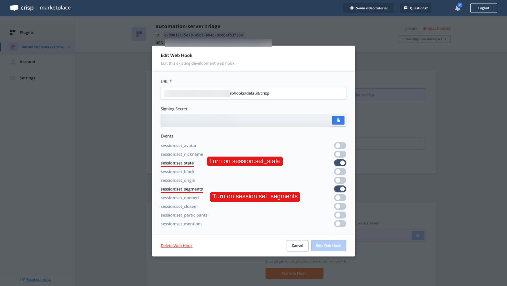

The Web Hooks block has a Development Web Hook and a Production Web Hook. The development hook delivers while the plugin is not yet activated. Use it to test, and add the production hook before you go live.

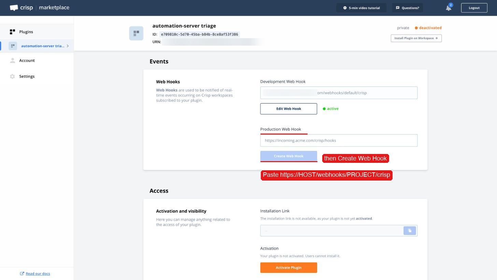

## 5. Activate and install the plugin

1. On the **Settings** tab, scroll to **Activation and visibility** and click **Activate Plugin**.
2. Copy the **Installation Link** that appears.
3. Open the link, pick your Crisp website and accept the scopes.

The production token and the production web hook only work after this step. If you only use the development hook, skip it while testing.

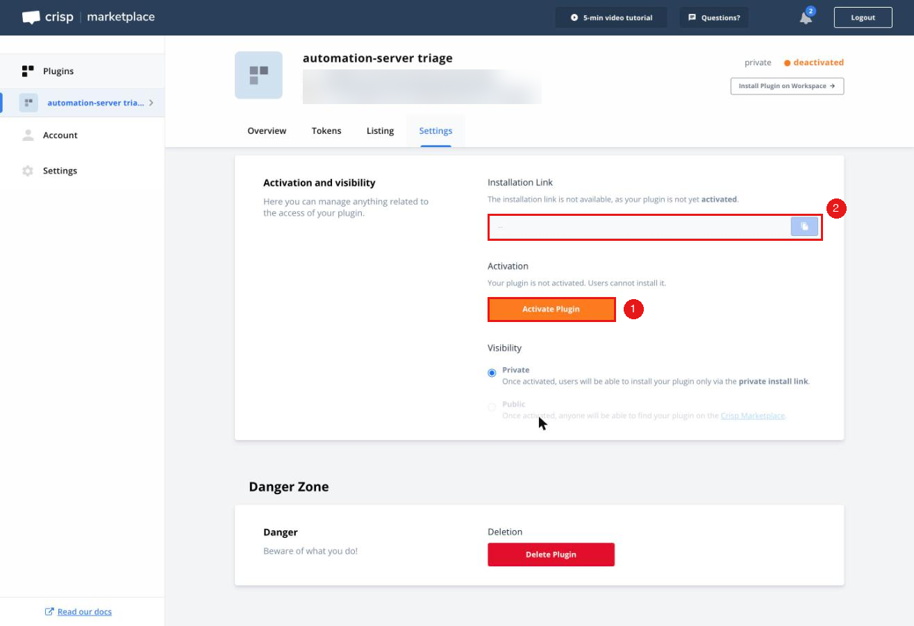

The screenshot shows a plugin that is not activated yet. The Installation Link stays empty until you click **Activate Plugin**.

## 6. Find the Website ID

1. In the Crisp app, click **Settings** in the left rail.
2. Open **Workspace**, then **Setup & Integrations**.
3. Click **Copy** next to **Website ID** and paste it into the admin field **Website ID**.

The server ignores deliveries for any other website.

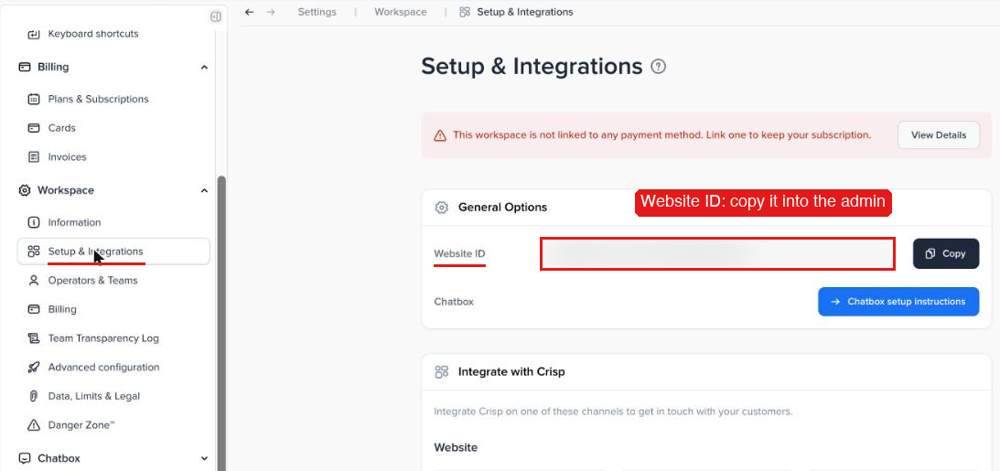

## 7. Save the settings in the admin

1. In the admin, open **Integrations** and click **Add integration**. Pick **Crisp**.
2. Fill the four required fields from steps 3 and 6, all in **Connection**. Leave the rest at their defaults for now.
3. Click **Save**, then **Test connection**. A working setup answers that the plugin token can read your website. Write access for notes and segments is only exercised by the first triage.

The webhook is served once the four required fields are set. The triage runs once OpenRouter is configured too.

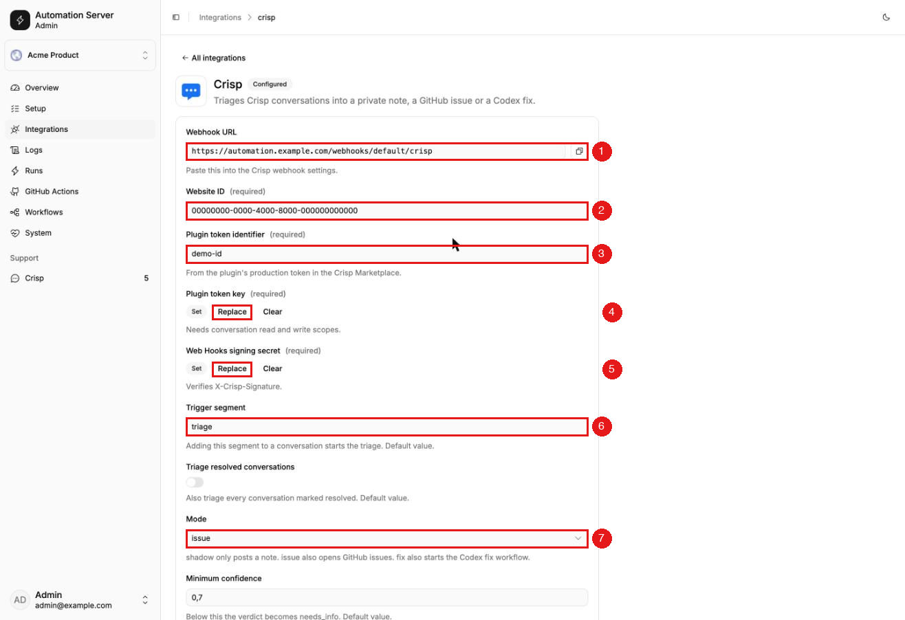

1. **Webhook URL.** Paste it into Crisp, step 5.
2. **Website ID.** From step 6.
3. **Plugin token identifier.** From the production token in step 3.
4. **Plugin token key.** Click **Replace** and paste the token key.
5. **Web Hooks signing secret.** Click **Replace** and paste the secret from step 5.
6. **Trigger segment.** The tag that starts a triage. Default `triage`.
7. **Mode.** `shadow`, `issue`, `fix` or `dry-run`. Start with `shadow`.

The fields below Mode (minimum confidence, product areas, autofix areas, workflow file) are optional and explained in [the integration page](../integrations/crisp.md#configuration).

## 8. Create the trigger segment

A segment is a tag on a conversation. The server starts a triage when the trigger segment is added. Crisp creates a segment the first time someone types it, so there is nothing to configure in Crisp settings.

1. In the Crisp inbox, open a conversation.
2. In the right panel, find **Segments for conversation**.
3. Click the field, type `triage` and press Enter.

The default name is `triage`. The match ignores case. To use another name, set **Trigger segment** in the admin to the same word.

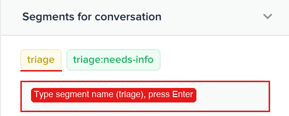

### How an operator uses it

1. Open the conversation that needs a verdict.
2. Add the segment `triage`.
3. After a few seconds the server adds a status segment next to it, for example `triage:needs-info`. It also posts a private note starting with `[automation-server triage]`.

The status segments are `triage:drop`, `triage:needs-info`, `triage:answer`, `triage:issue` and `triage:fix`. A conversation that already has one is skipped. To triage again, remove the status segment, then remove and re-add `triage`.

The server only ever adds segments that start with `triage:`. Do not use that prefix for your own segments.

## 9. Choose the mode and tune the rest

In the admin, Integrations, Crisp:

| Field | Set it to |
| --- | --- |
| **Mode** | Start with `shadow`. It only reports the decision. `issue` also opens GitHub issues. `fix` also starts the Codex fix workflow. `dry-run` does what `fix` would but writes nothing to Crisp or GitHub, and the Runs page shows what each run would have done. |
| **Product areas** | The closed list the classifier picks the area from. |
| **Autofix areas** | Areas whose non-blocker bugs go to the fix workflow. Empty means no fixes. |
| **Triage resolved conversations** | On to triage every resolved conversation without a segment. Needs the `session:set_state` event. |
| **Minimum confidence** | Default `0.7`. |

Every field and default is listed in the [integration page](../integrations/crisp.md#configuration).

## 10. The Support page in the admin

Once the Crisp integration is added, the admin sidebar shows a **Support** group with **Crisp** and an unread count.

- The page lists every triaged conversation, newest first, and refreshes by itself.
- Click a decision counter to filter. Switch **All** and **Unread**, or search.
- Click a row to open the side panel. It marks the conversation as read. The panel offers **Open in Crisp**, **Mark as unread**, the draft answer with **Copy draft**, the questions with **Copy questions**, the private note with **Copy note**, the reproduction, quoted evidence and the technical details.
- **Mark all as read** clears the count. The read state is stored on the server.

The page works on every Crisp plan, including the ones that refuse API notes. Details are in [the integration page](../integrations/crisp.md#the-crisp-page-in-the-admin).

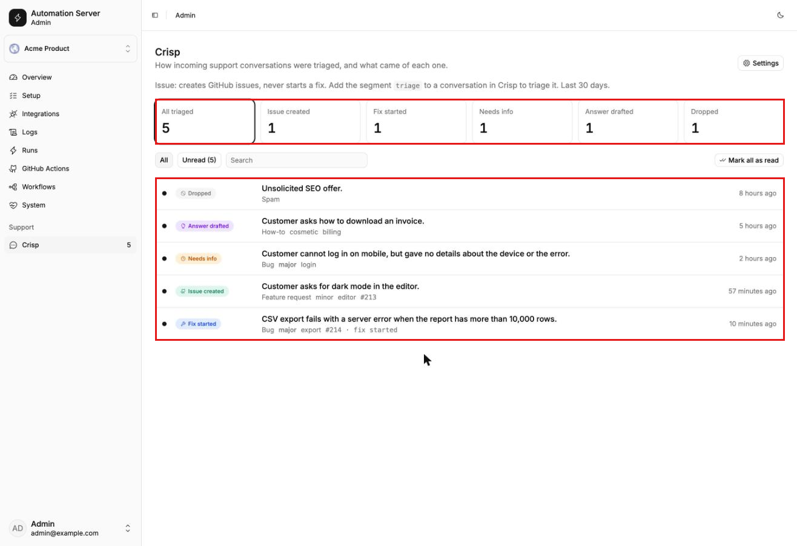

Click a row to open the side panel. This one is a conversation the triage sent to the Codex fix workflow.

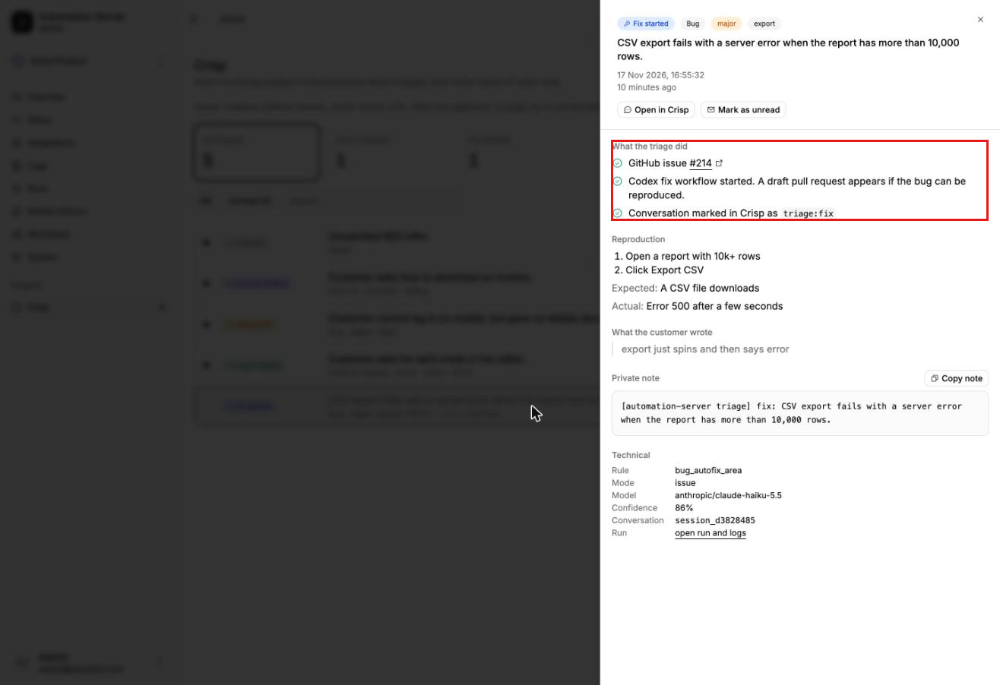

## 11. Test it

1. Keep **Mode** at `shadow`.
2. In Crisp, open a test conversation whose customer text describes a problem. Do not use a real customer.
3. Add the segment `triage`.
4. Within a few seconds the conversation gets a status segment such as `triage:issue`. On a paid plan it also gets a private note.
5. Open **Support**, **Crisp** in the admin. The conversation appears with its decision and summary.
6. If nothing happens, open **Logs** and **Runs** in the admin and look for the delivery.

| Symptom | Likely cause |
| --- | --- |
| Delivery rejected with 401 | The **Web Hooks signing secret** does not match the plugin, or the server clock is more than five minutes off. |
| Delivery accepted, no run | The segment name differs from **Trigger segment**, the **Website ID** is for another website, or OpenRouter is not configured. |
| Plugin token cannot read the website | The plugin is not installed on the website (step 5) or the scopes were not approved yet. |
| Run fails with `402` on the note | See the next section. |

### Try it without writing anything

Set **Mode** to `dry-run`, or open any finished run in the admin and press **Dry run** next to Replay. Both call the model and read GitHub, but write no note, no segment and no issue. The run is marked Dry run and its page lists what it would have done. Dry runs do not appear on the Support page.

## Plans that refuse API writes

A free Crisp workspace refuses to write private notes through the API and answers `402 subscription_upgrade_required`. The triage does not fail on it. The note is shown on the admin Crisp page and written to the server log with the message `triage note not posted to crisp`. The status segment is still set. The GitHub issue is still created in modes `issue` and `fix`.

On a free plan use `issue` mode, because `shadow` only reports through the note. If the segment write is refused too, the admin page is the only place where the verdict is visible.
