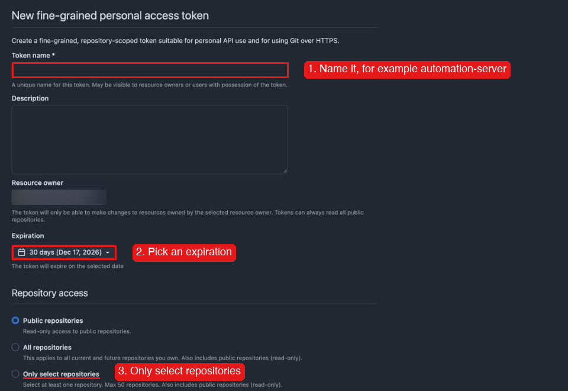
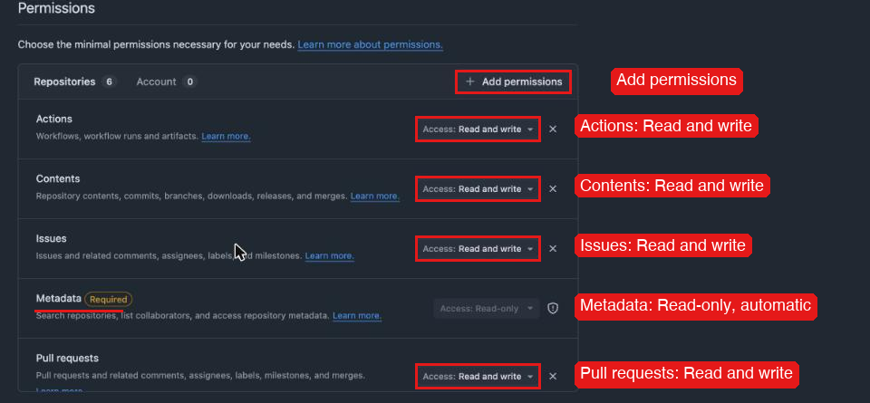
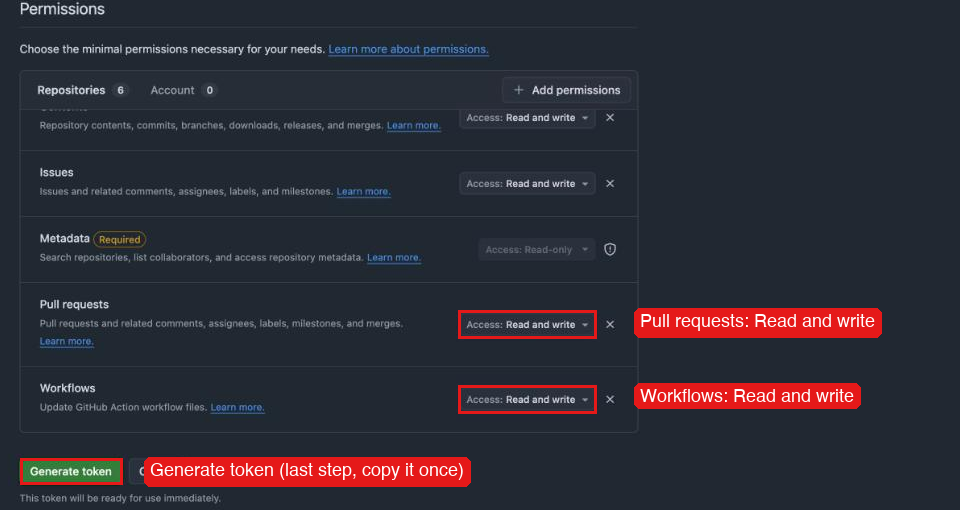
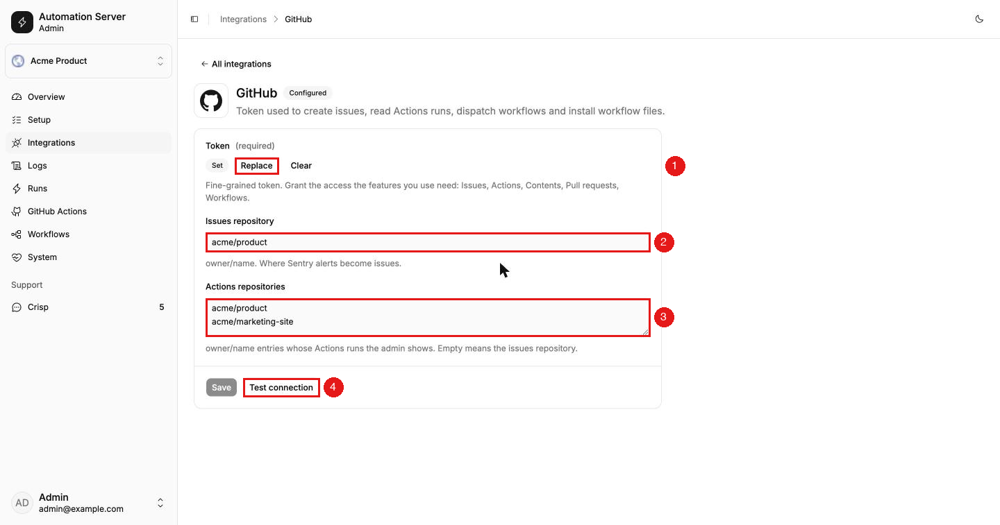
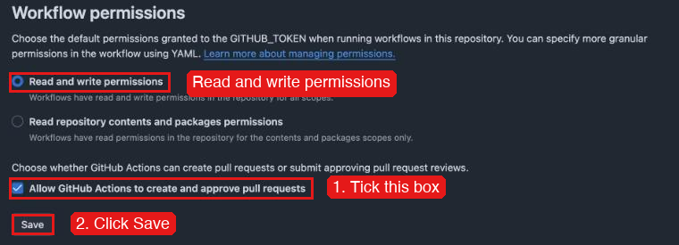
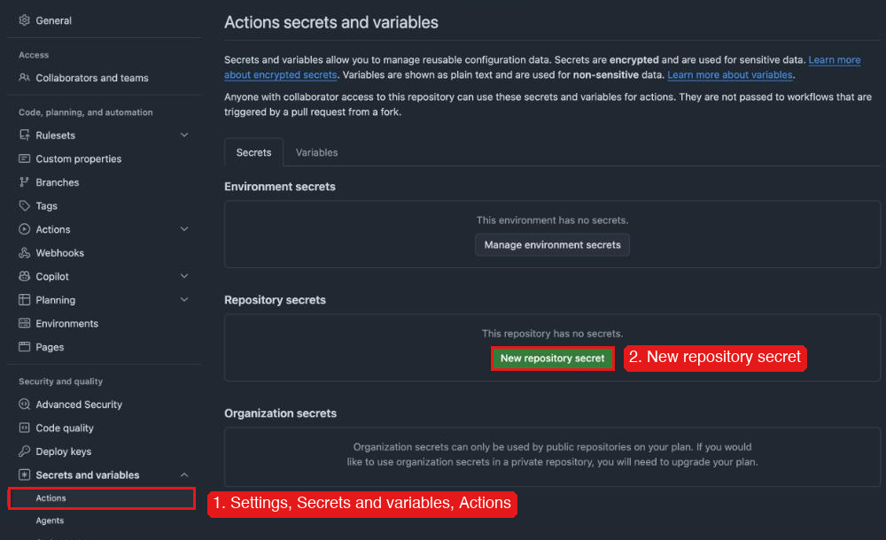
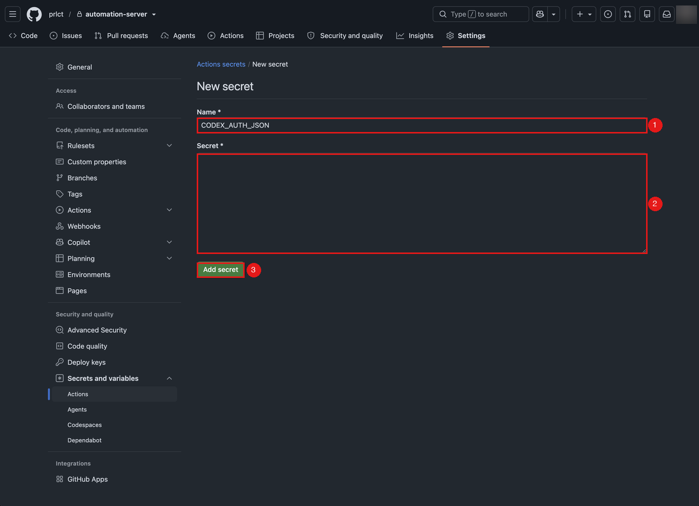
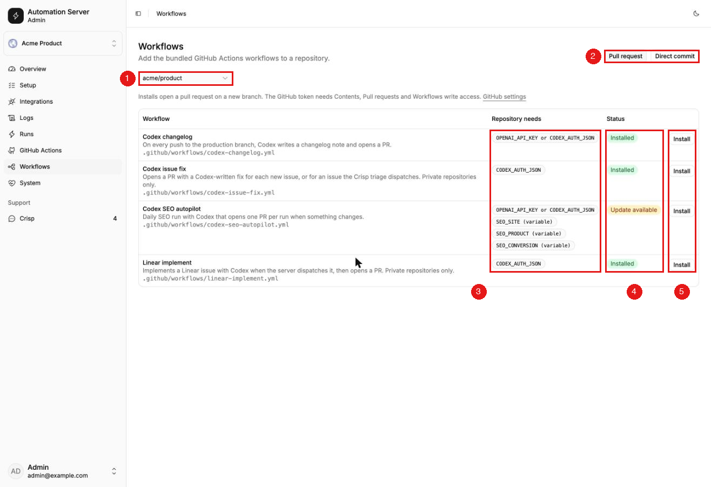
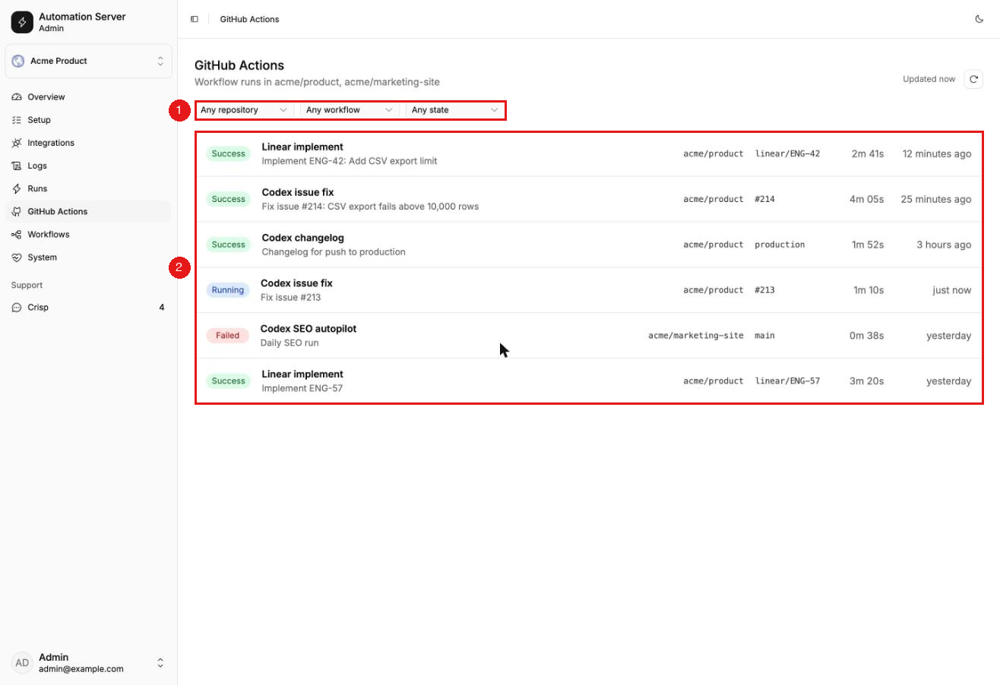

# Set up GitHub

GitHub is the shared backend of three integrations. One fine-grained token and one repository cover all of them. This guide creates the token, sets the repository in the admin, adds the Codex secret and installs the workflows.

What each integration does with GitHub is documented in [Sentry](../integrations/sentry.md), [Linear](../integrations/linear.md) and [Crisp](../integrations/crisp.md). This page only covers the GitHub side.

## What you need

- Admin rights on the target repository, or the right to ask someone who has them.
- The admin app of this project, open on its Integrations page.
- A private target repository. The Codex workflows refuse to run in public ones.
- For the Codex secret, a ChatGPT login for the Codex CLI on your machine.

## 1. Create a fine-grained token

1. Open https://github.com/settings/personal-access-tokens/new. The path is your avatar menu, Settings, Developer settings, Personal access tokens, Fine-grained tokens, Generate new token.
2. Enter a Token name, for example `automation-server`.
3. Pick an Expiration. Note the date. The server stops working with GitHub when the token expires, so put a renewal reminder in your calendar.
4. Under Resource owner, pick the account or organization that owns the target repository.
5. Under Repository access, choose Only select repositories, then click Select repositories and pick the target repository. Add the second repository only if the Actions page should follow runs in more than one.

6. Under Permissions, click Add permissions and tick each row below. Then set each one to Read and write in its Access dropdown.

| Permission | Access | Used by |
| --- | --- | --- |
| Issues | Read and write | Sentry and Crisp create issues. Crisp reads open issues to find duplicates. |
| Actions | Read and write | Linear and Crisp dispatch workflows. The admin Actions page reads runs. |
| Contents | Read and write | Installing workflows from the admin writes files to the repository. |
| Pull requests | Read and write | Installing workflows in Pull request mode opens a PR. |
| Workflows | Read and write | GitHub requires it for any change under `.github/workflows/`. |
| Metadata | Read-only | Added by GitHub automatically. |

Scroll the permission list inside the box to see the last rows.

7. Click Generate token. GitHub shows the token once. It starts with `github_pat_`. Copy it now and paste it straight into step 2 below. Do not store it in a file or a chat.

If you only need Sentry, Issues write is enough. A missing permission shows up as a `401` or `403` from GitHub in the run, for example `Resource not accessible by personal access token`. Add the permission on the token page and the existing token keeps working, no new token is needed.

## 2. Save the token and repository in the admin

Open the admin, then Integrations, then GitHub. The token is in **Connection**, the repositories in **Repositories**.

| Field in the admin | Environment variable | Value |
| --- | --- | --- |
| Token | `GITHUB_TOKEN` | The `github_pat_xxx` token from step 1. |
| Issues repository | `GITHUB_REPO` | `owner/name` of the repository that receives Sentry and Crisp issues and runs the issue fix workflow. |
| Actions repositories | `GITHUB_ACTIONS_REPOS` | Optional list of `owner/name` entries. The admin Actions page shows their runs. Empty means the Issues repository. |

Click Save, then click Test connection. It confirms the token is valid and can see the repository.

The Linear integration has its own target repository field, `linear.targetRepo`. It can point at a different repository than the Issues repository. Give the token access to both in that case.

Values saved in the admin win over environment variables and apply without a restart. The variable names are listed in [`apps/server/.env.example`](../../apps/server/.env.example).

1. **Token.** A saved secret shows **Set** and is never displayed again. Click **Replace**, paste the new token and save to change it. **Clear** removes it.
2. **Issues repository.** Where Sentry alerts and Crisp triage become issues.
3. **Actions repositories.** One `owner/name` per line. The GitHub Actions page of the admin shows runs from these.
4. **Test connection.** Run it after **Save**.

## 3. Allow Actions to create pull requests

The Codex workflows open PRs with the job token. GitHub blocks this by default.

1. Open the target repository on GitHub.
2. Click Settings, then Actions, then General.
3. Scroll to Workflow permissions.
4. Choose Read and write permissions.
5. Tick Allow GitHub Actions to create and approve pull requests.
6. Click Save in that section.

If the box is greyed out, an organization setting overrides it. An organization owner must allow it under the organization's Settings, Actions, General first.

## 4. Add the CODEX_AUTH_JSON secret

All Codex workflows read this secret. It holds the Codex CLI login, so Codex runs on your ChatGPT plan.

1. On your machine, run `codex login` and finish the browser login. This writes `~/.codex/auth.json`.
2. Open the target repository on GitHub, then Settings, Secrets and variables, Actions.
3. Click New repository secret.
4. Name it exactly `CODEX_AUTH_JSON`.
5. Paste the full contents of `~/.codex/auth.json` into Secret, for example from `pbcopy < ~/.codex/auth.json` on macOS. Click Add secret.

Rules for this secret.

- Private repositories only. The workflows stop with an error in a public repository.
- The login token rotates every time Codex runs. To keep the secret fresh, add a second secret `GH_PAT_FOR_SECRET_WRITE`. It is a fine-grained token with Secrets set to Read and write on this repository. Without it, the workflow warns when the token changed, and you must paste the new `auth.json` yourself or the next run may fail.
- Never paste the file into an issue, a PR or a screenshot.
- Optional repository variables `CODEX_MODEL` and `CODEX_REASONING_EFFORT` (default `high`) are set on the Variables tab of the same page.

Details and the other optional secrets are in [github-actions/README.md](../../github-actions/README.md).

The Secret box is empty in the screenshot on purpose. Paste the file contents there, then click **Add secret**.

## 5. Install the workflows

Install from the admin instead of copying files by hand.

1. Open the admin, then Workflows.
2. Pick the repository from the list. It is built from the Issues repository, the Actions repositories and the Linear target repository.
3. Choose the install mode. Pull request opens a PR on a new branch. Direct commit writes to the default branch.
4. Install each template you use. The status badge reads Not installed, Installed or Update available.
5. In Pull request mode, merge the PR the admin opened. GitHub only runs a workflow once it is on the branch it dispatches to.

| Template | Needed by |
| --- | --- |
| `linear-implement.yml` | [Linear](../integrations/linear.md) |
| `codex-issue-fix.yml` | [Crisp](../integrations/crisp.md) in fix mode, and Sentry issues labelled `sentry` once a person dispatches them |
| `codex-seo-autopilot.yml`, `codex-changelog.yml` | Optional, not tied to an integration |

The skill folders that go with each workflow are installed by the same button.

1. **Repository picker.** The repository that receives the files.
2. **Install mode.** **Pull request** or **Direct commit**.
3. **Repository needs.** The secrets and variables the workflow reads. Add them in the repository before the first run (step 4 above).
4. **Status.** Installed, or Update available when the bundled template changed. A workflow that is not in the repository shows a dash.
5. **Install.** Writes the workflow and its skill into the repository.

What each workflow does is explained in [github-actions/README.md](../../github-actions/README.md#the-workflows-one-by-one).

## Check that it works

- In the admin, GitHub shows a successful Test connection.
- The Workflows page shows Installed for each template.
- Open the repository, then the Actions tab. The installed workflows are listed on the left. The same runs show in the admin, under GitHub Actions.

- For Linear, add the trigger label to a test issue and watch for a `Linear implement` run on the Actions tab.

## Troubleshooting

| Symptom | Cause and fix |
| --- | --- |
| `404` when dispatching a workflow | The workflow is not on the target branch, or the token cannot see the repository. Install and merge it, then check Repository access on the token. |
| `422` when dispatching | The workflow has no `workflow_dispatch` trigger, or the branch does not exist. Reinstall the template. |
| `401` or `403` | The token lacks a permission from the table above, or it expired. Edit the token at https://github.com/settings/personal-access-tokens. |
| Workflow fails on `gh pr create` | Step 3 was skipped. Allow Actions to create pull requests. |
| Installing a workflow fails with a permission error | The token is missing Workflows or Contents write. |
| The run says `CODEX_AUTH_JSON` is not set | Step 4 was skipped, or the secret is in another repository. |
