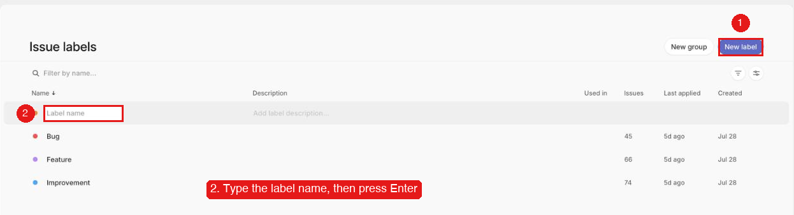
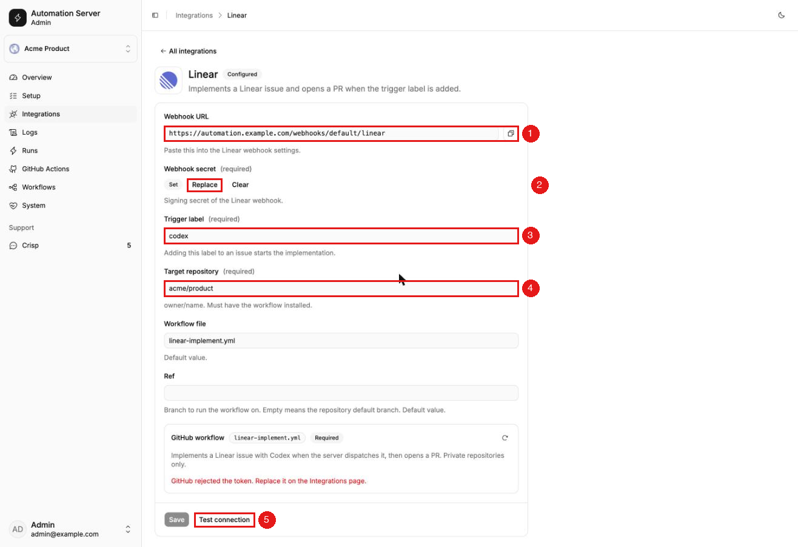
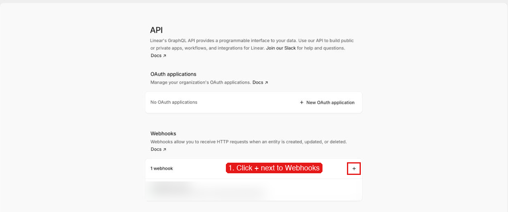
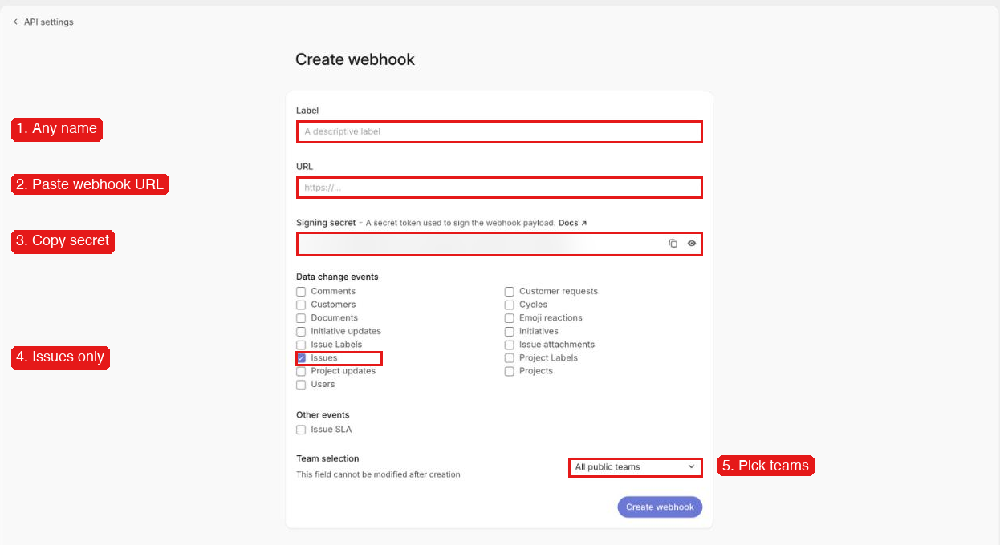
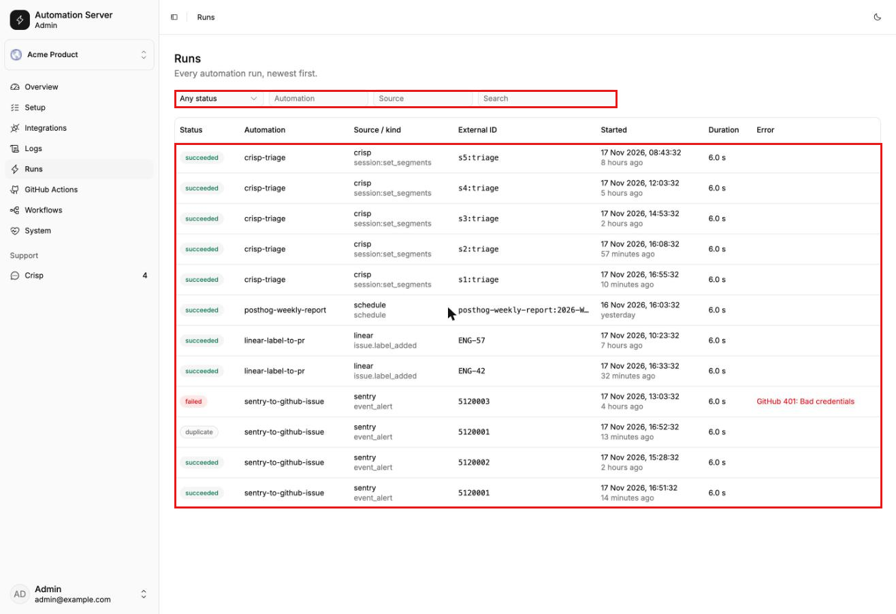

# Set up Linear

This guide connects Linear to automation-server. When someone adds the trigger label to a Linear issue, the server starts a GitHub Actions workflow. Codex implements the issue and the workflow opens a PR that Linear links back to the issue.

For what the integration does once it runs, see [docs/integrations/linear.md](../integrations/linear.md).

You need a Linear workspace admin account for steps 2 and 3, because only admins can create webhooks.

## What you will set

| Where | Value | Comes from |
| --- | --- | --- |
| Admin, Integrations, Linear, **Webhook secret** | Signing secret | Linear webhook form (step 3) |
| Admin, Integrations, Linear, **Trigger label** | Label name, for example `codex` | Linear label (step 1) |
| Admin, Integrations, Linear, **Target repository** | `owner/name` of the repo that receives the PR | GitHub |
| Admin, Integrations, Linear, **Workflow file**, **Ref** | Optional. Defaults are `linear-implement.yml` and the default branch | |
| Admin, Integrations, Linear, **API key** | Optional. A personal API key (Linear Settings, Security & access). Lets the [Slack bot](slack-bot.md) search and read issues. Env: `LINEAR_API_KEY`. **Test connection** checks it with a `viewer` query | Linear |

The only environment variable is `LINEAR_API_KEY`. Everything is saved from the admin Integrations page and applies without a restart. The GitHub token comes from the GitHub integration, and the target repository needs the workflow installed first. See [Setup in docs/integrations/linear.md](../integrations/linear.md#setup).

## 1. Create the trigger label

1. Open Linear, then Settings, then **Issues**, then **Labels**. The direct link is `https://linear.app/<your-workspace>/settings/issue-labels`.
2. Click **New label** at the top right.
3. Type the label name, for example `codex`, and press Enter.



A workspace label works for every team. You can also create the label inside one team, which limits it to that team.

Remember the exact name. The server compares it case-insensitively.

## 2. Build the webhook URL

The URL has this shape.

```
https://<your-host>/webhooks/<project>/linear
```

- `<your-host>` is the public host of automation-server.
- `<project>` is the project path. The default project is `default`, so the URL is `https://<your-host>/webhooks/default/linear`. The default project also answers `https://<your-host>/webhooks/linear`.

To copy the full URL, open the admin Integrations page and open Linear. The **Connection** section shows the URL when `PUBLIC_URL` is set on the server. Without `PUBLIC_URL` it shows only the path, and you add the host yourself.

The Linear form in the admin, with every field you will touch in the next steps.



## 3. Create the webhook in Linear

1. Open Linear, then Settings, then **Administration**, then **API**. The direct link is `https://linear.app/<your-workspace>/settings/api`.
2. In the **Webhooks** section, click the **+** button on the right of the "webhook" row.



3. The **Create webhook** form opens. Fill it in.
   1. **Label.** Any name, for example `automation-server`.
   2. **URL.** Paste the URL from step 2.
   3. **Signing secret.** Linear generates it for you and shows it in the form. Click the copy icon next to it and keep it for step 4.
   4. **Data change events.** Check **Issues** only. It is checked by default. Leave the other boxes empty.
   5. **Team selection.** Choose the teams that may trigger runs. The default is **All public teams**. Linear cannot change this after creation, so create a new webhook to change the teams.



4. Click **Create webhook**.

The signing secret in the screenshot is blurred on purpose. Treat your own secret like a password and do not paste it into chat, tickets or commits.

## 4. Save the settings in the admin

1. Open the admin Integrations page and open Linear. If it is already configured, click **Edit** on the section that holds a field.
2. Paste the signing secret into **Webhook secret**.
3. Enter the label name from step 1 into **Trigger label**.
4. Enter `owner/name` of the repository that should receive the PR into **Target repository**.
5. Save.
6. Click **Test connection**. It checks that the GitHub token is set and that the workflow is installed and active in the target repository.

The Linear source registers once the webhook secret, trigger label and target repository are set. The automation registers once the GitHub token is set too.

## 5. Link the PR back to the issue

The workflow creates the branch `linear/<identifier>` and starts the PR title with the issue identifier, such as `ENG-42`. Linear's GitHub integration uses that to attach the PR to the issue.

1. In Linear, open Settings, then **Integrations**, then **GitHub**, and connect the GitHub account or organization that owns the target repository.
2. Make sure the target repository is selected for the integration.

Without this connection the PR still opens, but Linear does not show it on the issue.

## 6. Test end to end

1. Open a Linear issue in one of the teams you selected. Give it a clear title and description.
2. Add the trigger label to the issue.
3. Open the admin Runs page. A run for `linear-label-to-pr` appears within a few seconds. A successful run means the workflow was dispatched.
4. Open the target repository on GitHub, then **Actions**. The `linear-implement` workflow is running.
5. When the workflow ends, a PR titled with the issue identifier opens, and Linear shows it on the issue.

The Runs page of the admin lists every run. A `linear-label-to-pr` row with the status `succeeded` and the issue identifier such as `ENG-42` means the workflow was dispatched.



Only a newly added label triggers a run. To run the same issue again, remove the label and add it again.

## Troubleshooting

| Symptom | Likely cause |
| --- | --- |
| No run appears after adding the label | The webhook URL or project path is wrong, the issue's team is not selected on the webhook, or the label name differs from **Trigger label**. |
| Linear shows a failed delivery with `401` | The signing secret in the admin does not match the one in Linear, or the server clock is more than 60 seconds off. |
| Run fails with a GitHub `404` or `422` | The workflow is not installed in the target repository, or it has no `workflow_dispatch` trigger. Use the admin Workflows page. |
| Run fails with `401` or `403` | The GitHub token lacks Actions read and write on the target repository. |

To see the delivery status of a webhook, open it from the Webhooks list in Linear.
