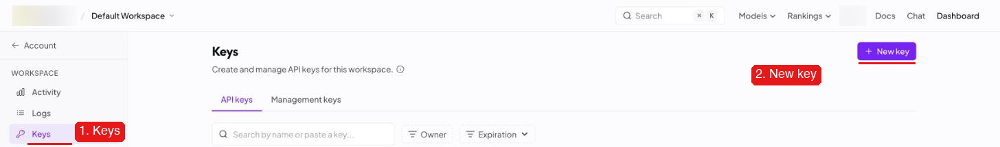
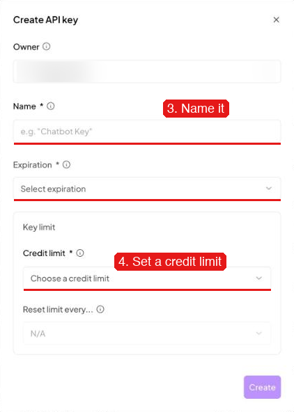
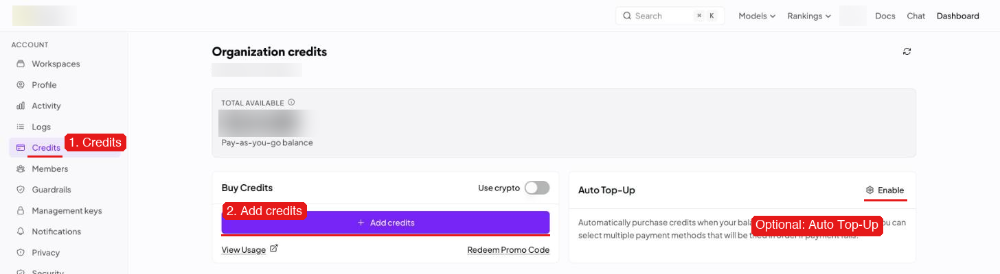
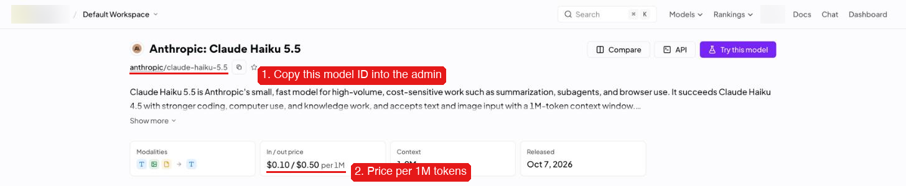
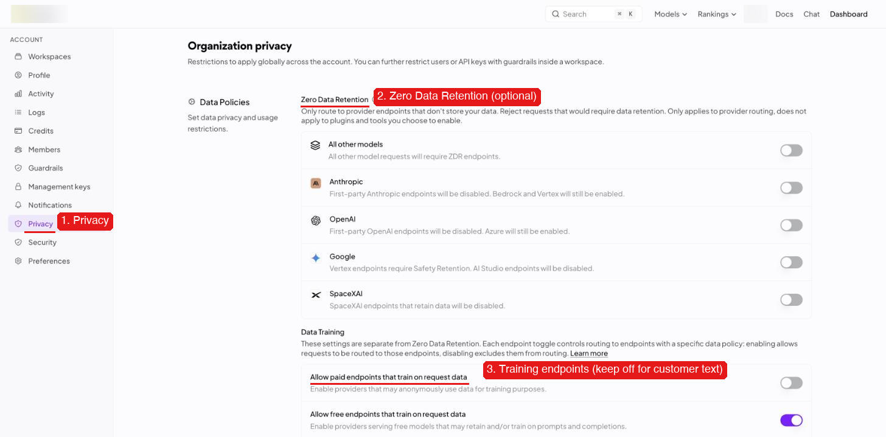

# OpenRouter setup

OpenRouter gives the server one API for many LLMs. The Crisp triage uses it to classify a conversation. This guide creates the API key, puts credit behind it and saves it in the admin.

What the triage does with the models is described in [docs/integrations/crisp.md](../integrations/crisp.md).

## What you need

- An OpenRouter account. Sign up at [openrouter.ai](https://openrouter.ai/) if you have none.
- Access to the admin of this server, page **Integrations**.

The OpenRouter integration has no environment variables. All three fields are saved from the admin only.

| Admin field | Required | Default | Used for |
| --- | --- | --- | --- |
| API key | yes | | Authenticates every request. Stored as a secret. |
| Triage model | no | `anthropic/claude-haiku-5.5` | First pass over every conversation. |
| Escalation model | no | `anthropic/claude-sonnet-5.5` | Second pass for bugs and unsure verdicts. |

## 1. Open the Keys page

1. Open [openrouter.ai/settings/keys](https://openrouter.ai/settings/keys). It redirects to the keys of your workspace.
2. In the left sidebar the **Keys** item is selected. The page title is **Keys** and the **API keys** tab is active. Do not use the **Management keys** tab. A management key cannot run completions.

## 2. Create the API key

1. Click **New key** in the top right.
2. In the **Create API key** dialog set the fields.
   - **Owner** stays on your own account, or pick the workspace if the key should outlive you.
   - **Name** is any label, for example `automation-server`. It only helps you find the key later.
   - **Expiration** is required. Pick a date you will remember to rotate, or the longest option if you prefer no rotation.
   - **Credit limit** is required. This is the cost cap for this key, see step 4. Optionally set **Reset limit every...** to make the cap monthly or weekly instead of a lifetime total.
3. Click **Create**.
4. OpenRouter shows the key once. It starts with `sk-or-v1-`. Copy it right away. You cannot read it again later, you would have to create a new key.

Never paste the key into a chat, a ticket or the repository. The admin stores it encrypted.

## 3. Save the key in the admin

1. Open the admin and go to **Integrations**.
2. Open the **OpenRouter** integration.
3. Paste the key into **API key**. It looks like `sk-or-v1-xxx`.
4. Leave **Triage model** and **Escalation model** empty to keep the defaults, or fill them as described in step 5.
5. Save.

The Crisp triage starts working once this integration is configured. Until then the Crisp webhook is accepted but no triage runs.

## 4. Add credit and set limits

OpenRouter is pay as you go. Requests fail with a `402` error when the account has no credit left.

1. Open [openrouter.ai/settings/credits](https://openrouter.ai/settings/credits).
2. Under **Buy Credits** click **Add credits** and complete the payment. Start small, for example 10 dollars.
3. Optional. Under **Auto Top-Up** click **Enable** to buy credit automatically when the balance falls below a threshold. Leave it off while you are testing.
4. Click **View Usage** or open the **Activity** and **Logs** items in the sidebar to see what each request cost.

Two caps protect you.

- The per-key **Credit limit** from step 2 stops that key once it has spent the amount. You can change it later from the key's row menu on the Keys page.
- The account balance is the hard ceiling for all keys.

The triage sends one short classification request per conversation, plus a second one when it escalates. With the default models this is a fraction of a cent per conversation. A limit of 5 dollars is plenty for a test and a small team.

## 5. Choose the models

Both fields take an OpenRouter model ID, which is `author/model-slug`.

1. Open [openrouter.ai/models](https://openrouter.ai/models) and find a model. Open its page.
2. Copy the ID under the model name, for example `anthropic/claude-haiku-5.5`. The copy icon next to it copies it.
3. Check the **In / out price** box for the price per 1M tokens.
4. Paste the ID into **Triage model** or **Escalation model** on the admin OpenRouter integration and save.

How the two models are used.

- The triage model classifies every conversation. Pick a fast, cheap model.
- The escalation model runs a second time when the triage model is below the **Minimum confidence** set on the Crisp integration, or when it says the conversation is a bug. Pick a stronger model. It is called less often, so a higher price is acceptable.
- Setting both to the same model works. It just removes the cheap first pass.

Requirements for any model you choose.

- It must support structured outputs (JSON schema). Requests set `provider.require_parameters`, so OpenRouter only routes to providers that honor them. A model without structured outputs fails every request.
- The server sends no `temperature`, because some newer models reject it.
- The model must be available to your account. Check that it is not blocked by the privacy settings in step 6.

## 6. Privacy and data policy

Conversation text reaches the model provider through OpenRouter. The server redacts emails, tokens and similar values before sending, and never sends attachments. Still, decide which providers may see the rest.

1. Open [openrouter.ai/settings/privacy](https://openrouter.ai/settings/privacy).
2. Under **Zero Data Retention** you can require endpoints that do not store your data. Turn it on for **All other models** or for a single vendor. If a model then has no zero retention endpoint, requests fail with a routing error, so test after changing it.
3. Under **Data Training** keep **Allow paid endpoints that train on request data** off. Customer text should not be used for training.
4. Keep the free-endpoint toggles off for the same reason. Free models are not a good fit for customer text. The triage needs structured outputs, which most free models lack.

These settings apply to the whole organization. A stricter rule for one key goes through **Guardrails** in the workspace sidebar.

## 7. Check that it works

1. Confirm the key in the admin shows as set on the OpenRouter integration.
2. Add the trigger segment to a test conversation in Crisp, as described in [docs/integrations/crisp.md](../integrations/crisp.md).
3. Open the **Support** group, **Crisp** page in the admin. The row shows the model that decided it.
4. On OpenRouter open **Activity** in the sidebar. The request appears with its cost and the key it used.

## Troubleshooting

| Symptom | Cause and fix |
| --- | --- |
| Run fails with `401` | The key is wrong, deleted or expired. Create a new key and save it again. |
| Run fails with `402` | No credit on the account, or the key reached its credit limit. Add credit or raise the key limit. |
| Run fails with `404` or "no endpoints found" | The model ID is misspelled, or the privacy settings leave no provider that supports structured outputs. Fix the ID or relax the setting. |
| Run fails with `429` | Rate limit of the model or provider. Retry later or choose another model. |
| "returned no valid JSON" | The model ignores structured outputs. Choose another model. |

<!-- screenshot needed: the OpenRouter integration card in the admin Integrations page. The admin was not part of this capture session. -->
