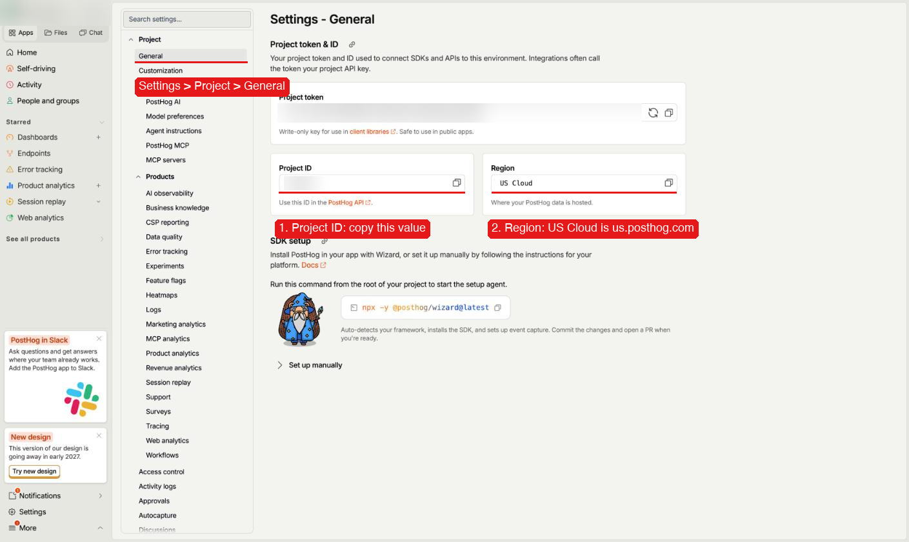
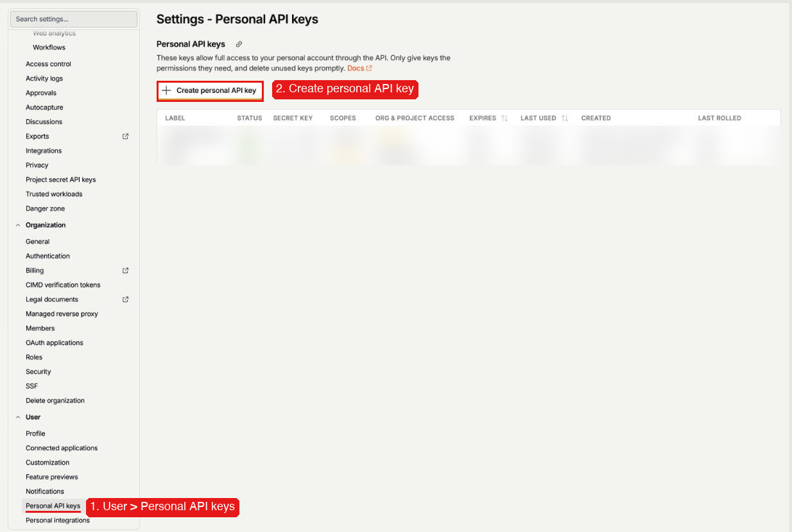
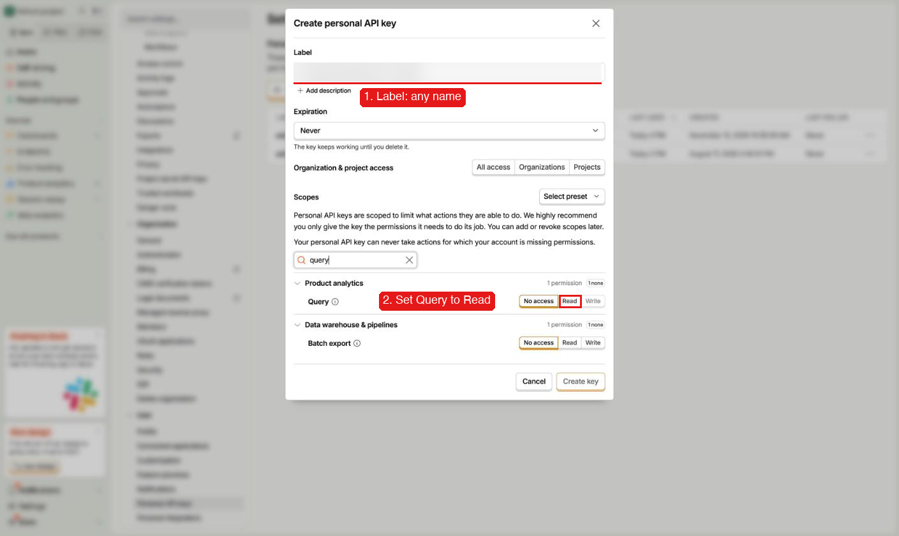
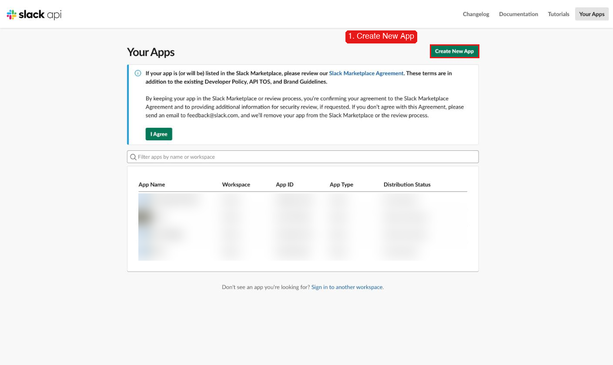
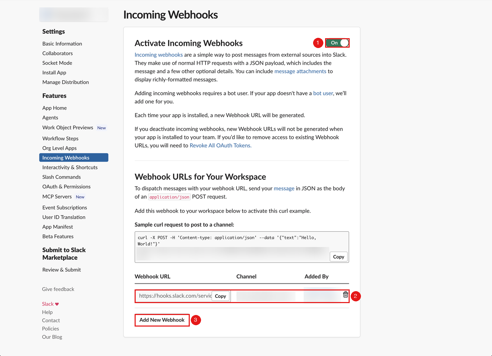
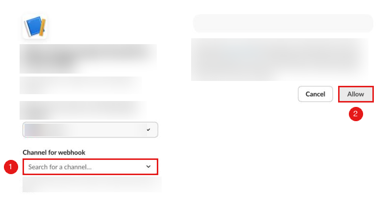
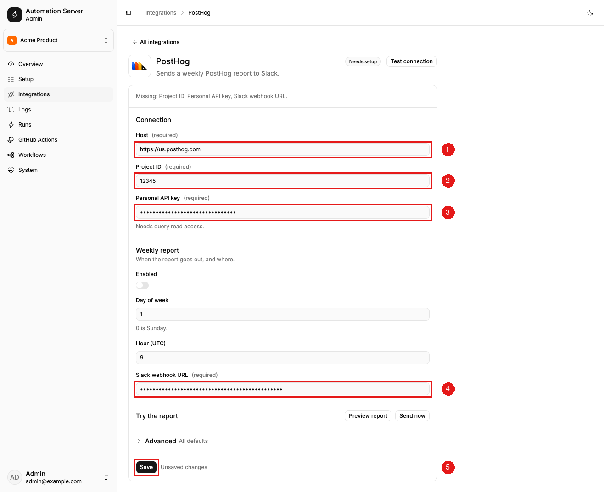

# Set up PostHog

This guide connects PostHog to the admin so a weekly report posts to a Slack channel. For what the report contains, the schedule rules and the admin API, read [docs/integrations/posthog.md](../integrations/posthog.md).

PostHog sends nothing to this server. The server calls PostHog on a schedule, so there is no webhook URL to paste into PostHog. There are no environment variables for this integration. Everything is entered on the admin Integrations page, under PostHog.

Before you start, make sure the server has `SETTINGS_ENCRYPTION_KEY` set. The admin refuses to save the two secrets below without it.

You will collect four values.

| Value | Where it comes from | Admin field |
| --- | --- | --- |
| Host | Your PostHog region | Host |
| Project ID | PostHog project settings | Project ID |
| Personal API key (`phx_xxx`) | PostHog user settings | Personal API key |
| Slack webhook URL | Slack app | Slack webhook URL |

## 1. Find the host and the project ID

1. Sign in to PostHog and open the project you want to report on.
2. Open **Settings**, then **Project**, then **General**.
3. In the **Project token & ID** section, find the **Project ID** box and click the copy icon. This is a number. Save it for the admin field **Project ID**. Do not copy the **Project token** above it. That is a different value and the report does not use it.
4. In the **Region** box, read the region.

Use the region to pick the host.

| Region | Host |
| --- | --- |
| US Cloud | `https://us.posthog.com` |
| EU Cloud | `https://eu.posthog.com` |
| Self-hosted | The URL of your instance, for example `https://posthog.example.com` |

The admin field **Host** defaults to `https://us.posthog.com`. Change it only for EU Cloud or a self-hosted instance. Do not add a trailing path.

## 2. Create a personal API key

The key is created in your user settings, not in the project settings.

1. In the settings sidebar, scroll to the **User** group and click **Personal API keys**.
2. Click **Create personal API key**.

3. In **Label**, type a name such as `automation-server`.
4. Leave **Expiration** on `Never`, or pick a date and plan to rotate the key.
5. Under **Organization & project access**, prefer **Projects** and select only the project from step 1. **All access** also works.
6. Under **Scopes**, type `query` in the search box. In the **Product analytics** group, set **Query** to **Read**. Leave every other scope at **No access**.

7. Click **Create key**.
8. PostHog shows the key once. It starts with `phx_`. Copy it now and keep it for the admin field **Personal API key**. If you lose it, delete the key and create a new one.

The report runs HogQL queries through `/api/projects/{projectId}/query/`. That endpoint needs only the Query read scope.

## 3. Create the Slack incoming webhook

The report is posted to one Slack channel through an incoming webhook. A webhook URL is tied to one channel.

1. Open [api.slack.com/apps](https://api.slack.com/apps) and click **Create New App**.

2. Choose **From scratch**. Name it `PostHog report` and pick the workspace that owns the channel. Click **Create App**. You can also reuse an existing app and skip to step 3.
3. In the app's left sidebar, under **Features**, click **Incoming Webhooks**.
4. Turn the **Activate Incoming Webhooks** switch on.
5. Scroll down and click **Add New Webhook to Workspace**.
6. In the next screen, pick the channel from the dropdown. For a private channel, invite the app to it first. Click **Allow**.
7. Back on **Incoming Webhooks**, find the new row under **Webhook URLs for Your Workspace**. Click **Copy**. The URL looks like `https://hooks.slack.com/services/T000/B000/xxx`. Keep it for the admin field **Slack webhook URL**.

The page above is an app that already has one webhook. In a new app the list is empty and the button reads **Add New Webhook to Workspace**. The URL, workspace and channel are blurred in the screenshot.

Treat the URL as a secret. Anyone who has it can post to the channel. The report lists page paths and event names from your project, so pick a channel whose members may see them.

## 4. Fill in the admin

1. Open the admin and go to **Integrations**. Open **PostHog**.
2. Fill in the fields.

| Field | Value |
| --- | --- |
| Host | From step 1. |
| Project ID | From step 1. |
| Personal API key | The `phx_xxx` key from step 2. |
| Slack webhook URL | The `https://hooks.slack.com/services/...` URL from step 3. |
| Report title | Optional, under **Advanced**. First line of the report. Default `Weekly PostHog report`. |

3. Click **Save**. The page switches to a summary once the four required fields are set.

## 5. Choose the schedule

Click **Edit** on the **Weekly report** section, set these fields and click **Save**.

| Field | Meaning | Default |
| --- | --- | --- |
| Enabled | Turn on to put the weekly job on the schedule. | Off |
| Day of week | 0 is Sunday, 1 is Monday, up to 6 for Saturday. | 1 |
| Hour (UTC) | 0 to 23, in UTC. | 9 |

The default sends on Monday at 09:00 UTC. At most one report is sent per ISO week. Enabling the job after this week's time has passed sends this week's report on the next tick. See [Schedule and deduplication](../integrations/posthog.md#schedule-and-deduplication).

## 6. Test

Run these in order on the PostHog page. None of them needs **Enabled** to be on.

1. Click **Test connection**. It runs a small count query over the last day and shows the result. It tests the saved settings, so click **Save** first. A failure here means a wrong host, project ID or key scope.
2. In **Try the report**, click **Preview report**. The report text appears below it. Nothing is sent to Slack.
3. Click **Send now** and confirm the prompt. The report posts to the Slack channel. A manual send does not use up the weekly send, so the scheduled one still goes out.

If a step fails, check the error text on the page. Errors never include the key or the webhook URL.

| Symptom | Likely cause |
| --- | --- |
| 401 or 403 from PostHog | The key lacks Query read, or it is limited to a different project. |
| 404 from PostHog | Wrong Project ID, or the Host is the wrong region. |
| Slack error on send | The webhook was revoked, or the app was removed from a private channel. |
| Saving a secret is refused | `SETTINGS_ENCRYPTION_KEY` is not set on the server. |
