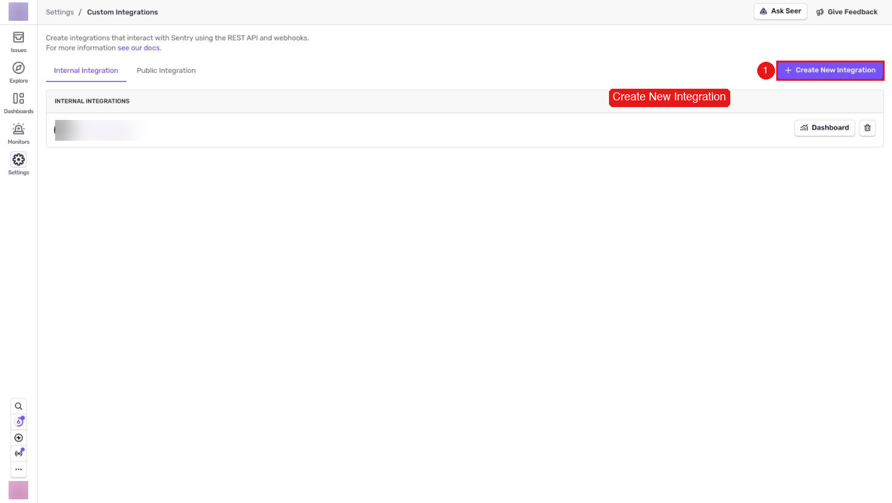
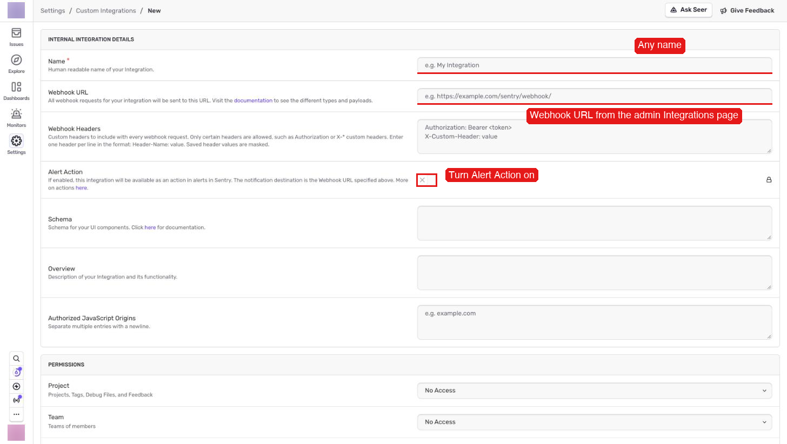
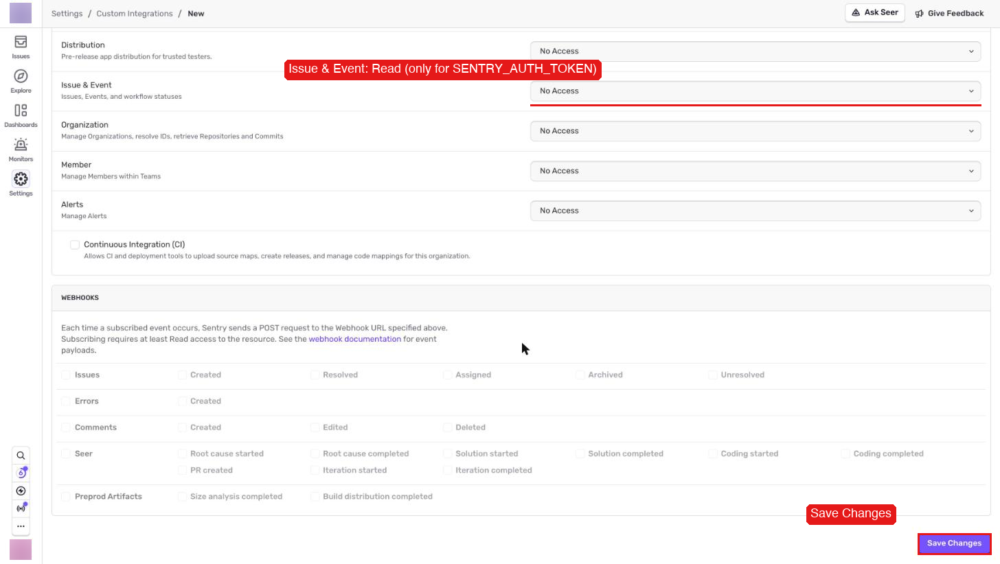
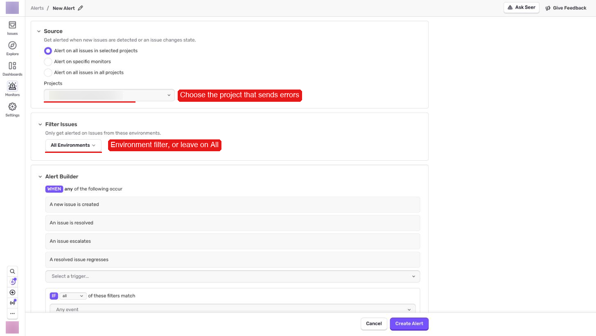
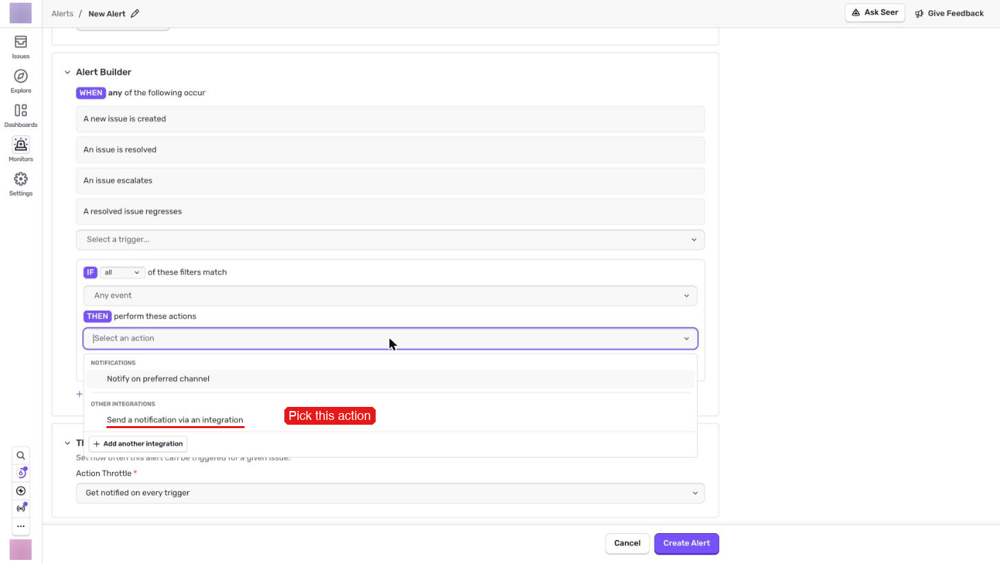
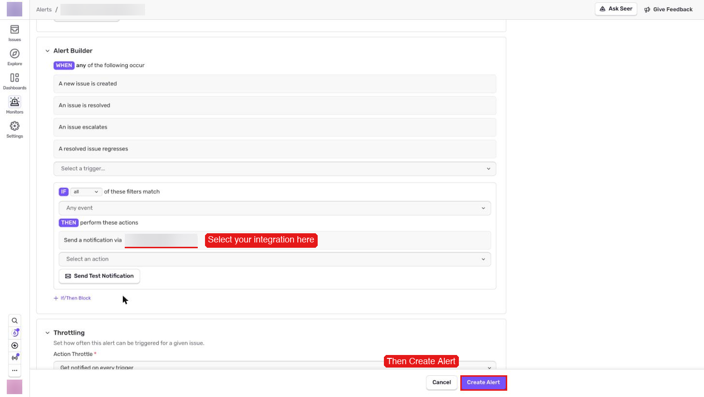

# Set up Sentry

This guide connects Sentry to automation-server. When a Sentry issue alert fires, the server creates one GitHub issue labelled `sentry`.

For what the integration does once it runs, see [docs/integrations/sentry.md](../integrations/sentry.md).

You need a Sentry account that can manage the organization (Manager or Owner) to create an internal integration, and permission to create alert rules in the project.

## What you will set

| Where | Value | Comes from |
| --- | --- | --- |
| Sentry, internal integration, **Webhook URL** | `https://<your-host>/webhooks/<project>/sentry` | Admin, Integrations, Sentry |
| Admin, Integrations, Sentry, **Client secret** (`SENTRY_CLIENT_SECRET`) | Client Secret | Sentry integration page (step 3) |
| Admin, Integrations, Sentry, **Auth token** (`SENTRY_AUTH_TOKEN`) | Optional. Token with Issue & Event read | Sentry integration page (step 4) |
| `SENTRY_LEVELS`, `SENTRY_ENVIRONMENTS`, `SENTRY_MIN_EVENT_COUNT`, `SENTRY_API_BASE_URL` | Optional filters and host | See [step 6](#6-filter-what-becomes-an-issue) |

Every value can be saved from the admin Integrations page without a restart, or set as an environment variable in `apps/server/.env`. A value saved in the admin wins over the variable. The GitHub side (`GITHUB_TOKEN`, `GITHUB_REPO`) is configured on the GitHub integration, see [Setup in docs/integrations/sentry.md](../integrations/sentry.md#setup).

## 1. Create an internal integration

1. In Sentry, open **Settings**, then **Developer Settings** (the page is titled **Custom Integrations**). The direct link is `https://<your-org>.sentry.io/settings/developer-settings/`.
2. On the **Internal Integration** tab, click **Create New Integration**.

## 2. Fill in the integration

1. **Name.** Any name, for example `automation-server`. You pick it again in step 5.
2. **Webhook URL.** Open the admin, then **Integrations**, then Sentry. Copy the webhook URL it shows for your project. It has the form `https://<your-host>/webhooks/<project>/sentry`. The default project also answers `/webhooks/sentry`.
3. **Alert Action.** Turn the toggle on. This makes the integration selectable as an alert action. Sentry labels it **Alert Action** in the form. Older docs and the admin setup page call it Alert Rule Action. It is the same toggle.
4. Leave Webhook Headers, Schema, Overview and Authorized JavaScript Origins empty.

## 3. Set permissions and save

1. Scroll to **Permissions**. The server needs no permission to receive alerts, so you can leave everything on **No Access**.
2. To also fetch event counts, set **Issue & Event** to **Read**. This is what `SENTRY_AUTH_TOKEN` needs in step 4.
3. In the **Webhooks** section, no resource is required. The alert action delivers the payload on its own. You can leave **Issues** and the other resources unchecked. Checking **Issues** only adds extra deliveries that the server does not use.
4. Click **Save Changes**.

After saving, Sentry opens the integration page. Under **Credentials** it shows the **Client Secret**. Click **Copy** next to it, then paste it into Admin, Integrations, Sentry, **Client secret** (`SENTRY_CLIENT_SECRET`). The server uses it to verify the signature of every webhook. Treat it like a password.

<!-- screenshot needed: integration page Credentials section with the Client Secret blurred. Not captured because the page shows a live secret. -->

## 4. Optional: copy a token for event counts

The alert payload has no event count, first seen or last seen. With a token the server reads them from the Sentry API. Without it, the minimum count filter is not applied and the GitHub issue omits those stats.

1. On the same integration page, find **Tokens**. Sentry creates one token for the integration when you save.
2. Copy it into Admin, Integrations, Sentry, **Auth token** (`SENTRY_AUTH_TOKEN`).
3. If the token list is empty, click **New Token** on that page. The token needs **Issue & Event: Read** from step 3.
4. If you use Sentry outside `sentry.io` (self-hosted or a region host), set `SENTRY_API_BASE_URL` to that origin. The token is only sent there.

<!-- screenshot needed: Tokens section of the integration page, blurred. Not captured because it reveals a live token. -->

## 5. Create the issue alert

1. In Sentry, open **Monitors**, then **Alerts**, then create a new alert and choose **Create an issue alert**. The direct link is `https://<your-org>.sentry.io/monitors/alerts/new/`. Older Sentry versions use **Alerts**, then **Create Alert**, then **Issues**.
2. Under **Source**, keep **Alert on all issues in selected projects** and choose the project that sends the errors you want.
3. Under **Filter Issues**, pick an environment or leave **All Environments**. See step 6 for how this relates to `SENTRY_ENVIRONMENTS`.

4. Under **Alert Builder**, pick a trigger. **A new issue is created** gives one GitHub issue per new Sentry issue. You can add **A resolved issue regresses** as well. A repeat alert for the same Sentry issue does not create a second GitHub issue.
5. Under **THEN perform these actions**, open **Select an action**. Choose **Send a notification via an integration**.

6. In the new row, open the dropdown after **Send a notification via** and pick the integration you created in step 2.

7. Under **Throttling**, **Get notified on every trigger** is fine. The server deduplicates by Sentry issue.
8. Click **Create Alert**.

## 6. Filter what becomes an issue

The server filters again after Sentry sends the alert. All three are optional.

| Variable | Default | Meaning |
| --- | --- | --- |
| `SENTRY_LEVELS` | `error,fatal` | Comma-separated levels that create an issue. Use `warning,error,fatal` to include warnings. |
| `SENTRY_ENVIRONMENTS` | empty (all) | Comma-separated environments, for example `production`. |
| `SENTRY_MIN_EVENT_COUNT` | `1` | Minimum event count. Applied only when `SENTRY_AUTH_TOKEN` is set. |

You can also narrow in Sentry. In the alert, set **Filter Issues** to one environment, or add a filter in the **IF** block, for example on the issue level or on how often it occurred. Filtering in Sentry stops the webhook from being sent at all. Filtering in the server only stops the GitHub issue.

## 7. Test

1. Make sure the GitHub integration has a token and a target repository. The Sentry source registers once the client secret is set. Issues are created once the GitHub values are set too.
2. In the alert from step 5, click **Send Test Notification** next to the action. Sentry sends a sample alert to the webhook URL.
3. Check the server log or the admin for a delivery. A `401` or a rejected signature means the Client Secret in the admin does not match the integration. Copy it again.
4. Check the target GitHub repository for a new issue labelled `sentry`. A real error in the selected project does the same.

The test payload can be filtered out by `SENTRY_LEVELS` or `SENTRY_ENVIRONMENTS`. If no issue appears, loosen the filters and send it again.

## Troubleshooting

| Symptom | Likely cause |
| --- | --- |
| The integration is missing from the action list | **Alert Action** was off when you saved, or the integration has no Webhook URL. Edit the integration and save again. |
| Delivery rejected with an invalid signature | Wrong or stale Client Secret in the admin, or a proxy that changes the request body. |
| No stats in the GitHub issue | `SENTRY_AUTH_TOKEN` is not set, lacks **Issue & Event: Read**, or `SENTRY_API_BASE_URL` does not match your Sentry host. |
| Nothing happens for a warning | Levels default to `error,fatal`. Set `SENTRY_LEVELS`. |
