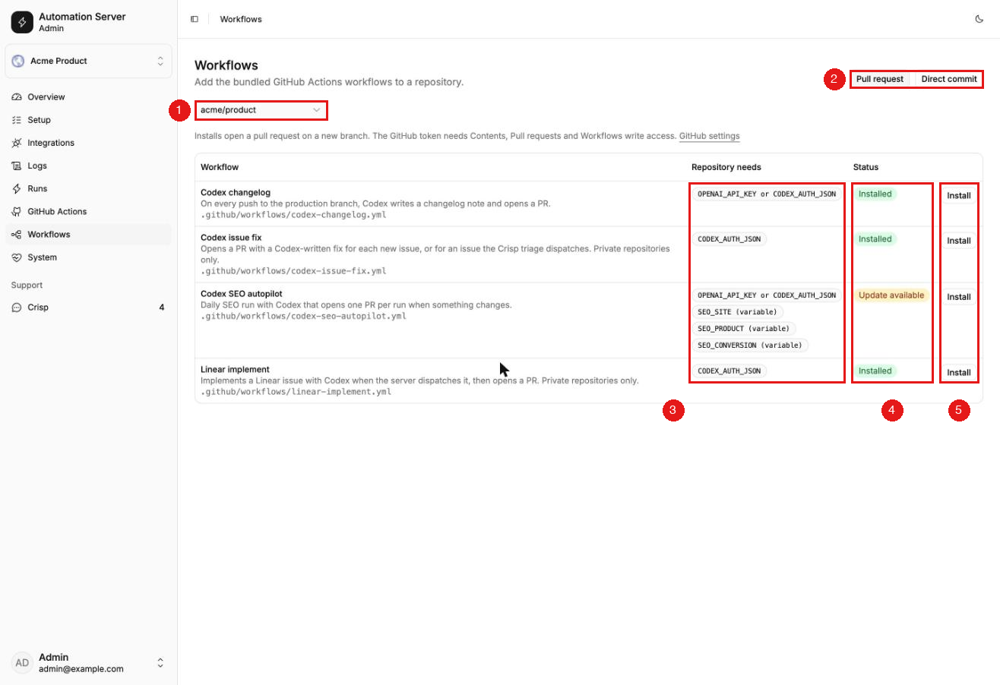

# GitHub Actions library

Workflow files kept here for reuse. They are **not active** in this repository: GitHub only runs files under `.github/workflows/`. To use one, install it from the admin's Workflows page, or copy it into the `.github/workflows/` directory of the target repository and adjust it.

The server bundles these files. After changing anything here, run `bun run generate:workflows`, and give a new workflow an entry in `TEMPLATE_META` in `packages/api/src/workflowTemplates.ts`. The tests fail until both are done.

| File | Purpose |
| --- | --- |
| [`codex-issue-fix.yml`](codex-issue-fix.yml) | Opens a draft PR with a Codex-written fix for each new issue, or for an issue named in a `workflow_dispatch`. |
| [`codex-seo-autopilot.yml`](codex-seo-autopilot.yml) | Daily run of the [seo-autopilot](https://il.ly/skills/seo-autopilot) skill with Codex. Opens one PR per run. |
| [`codex-changelog.yml`](codex-changelog.yml) | On every push to the production branch, Codex writes a changelog note from the pushed commits and opens a PR. |
| [`linear-implement.yml`](linear-implement.yml) | Dispatched by automation-server when a Linear issue gets the trigger label. Codex implements the task and opens a PR. |

## What these workflows are

A GitHub Actions workflow is a script that GitHub runs in the cloud when something happens in a repository: a push, a new issue, a schedule, or a call from outside. All four workflows here do the same kind of job. They start a **Codex** agent (OpenAI's coding agent) inside the repository, give it a task and a [skill](skills) that describes how to do that task, and then open a **pull request** with whatever Codex changed. A person reviews and merges it. Nothing is merged by itself.

```
trigger (issue, push, schedule, server call)
    |
    v
GitHub runs the workflow --> Codex reads the repo and the task --> edits files, runs checks
    |
    v
the workflow pushes a branch and opens a pull request --> you review it
```

Why the server is involved at all: automation-server is the part that listens to your other tools (Sentry, Linear, Crisp). It cannot write code, so when an event calls for a code change, it **dispatches** one of these workflows through the GitHub API. The admin's **Workflows** page installs the files into a repository for you.



Things every workflow has in common:

- **Codex login.** It runs on your ChatGPT plan through the secret `CODEX_AUTH_JSON` (or `OPENAI_API_KEY` where a workflow allows it). See [Set up GitHub](../docs/setup/github.md#4-add-the-codex_auth_json-secret).
- **Private repositories only** when `CODEX_AUTH_JSON` is used. The workflow stops in a public repository.
- **Actions may create pull requests.** One switch in the repository settings. See [Set up GitHub](../docs/setup/github.md#3-allow-actions-to-create-pull-requests).
- **One Codex run at a time.** They share the `codex-auth` queue, because the login token rotates on use.
- **Codex has no GitHub token.** The push and the pull request are made by a later step, which also refuses to touch `.github/` or `.agents/`.

## The workflows, one by one

| Workflow | Starts when | You get | Needs from you |
| --- | --- | --- | --- |
| [`codex-issue-fix.yml`](codex-issue-fix.yml) | A team member opens an issue, or the server dispatches it for one issue | A draft PR with a fix and a regression test | `CODEX_AUTH_JSON` |
| [`linear-implement.yml`](linear-implement.yml) | The server sees the trigger label added to a Linear issue | A ready-for-review PR that implements the issue | `CODEX_AUTH_JSON` |
| [`codex-changelog.yml`](codex-changelog.yml) | Every push to the production branch | A PR with a user-facing changelog note | `CODEX_AUTH_JSON` or `OPENAI_API_KEY` |
| [`codex-seo-autopilot.yml`](codex-seo-autopilot.yml) | Every day at 06:00 UTC, or by hand | A PR with SEO improvements for your site | `CODEX_AUTH_JSON` or `OPENAI_API_KEY`, plus site variables |

### Codex issue fix (`codex-issue-fix.yml`)

**What it is for.** Turning a bug report into a proposed fix without a developer picking it up first.

**How it works.**

1. It starts in one of two ways. A new GitHub issue is opened by the owner, a member or a collaborator of the repository (outsiders cannot trigger it, because the issue text is untrusted input for an agent that holds credentials). Or automation-server dispatches it for one issue number.
2. Codex reads the issue and runs the `fix-issue` skill. The skill sorts the issue into a real bug, a Sentry error, or too vague to act on.
3. For a bug it finds the root cause, prefers to write a **test that fails for the reported reason** (this is mandatory for `crisp` issues), makes the smallest fix that turns the test green, and runs the repository checks. A feature request or a vague report gets no change.
4. The workflow pushes a branch and opens a **draft** PR whose description is Codex's own summary. If Codex made no change, the workflow comments on the issue with a link to the run log, where Codex's reasoning is.

**Where the server fits.** Issues labelled `sentry` are created by the [Sentry integration](../docs/integrations/sentry.md) and take the Sentry path of the skill. Issues labelled `crisp` are created by the [Crisp integration](../docs/integrations/crisp.md) and are skipped on open: only the ones the triage routes to a fix are dispatched by the server.

**Result.** A draft PR, or an issue comment pointing at the run log when there is none.

### Linear implement (`linear-implement.yml`)

**What it is for.** Letting a product person hand a small, well-described Linear task to Codex by adding one label.

**How it works.**

1. Someone adds the trigger label (for example `codex`) to a Linear issue.
2. Linear sends a webhook to automation-server, which verifies it and calls the GitHub API to dispatch this workflow with four inputs: the issue identifier, title, link and description.
3. Codex runs the `implement-task` skill: it reads the repository, plans the change, implements it, adds or updates tests and runs the checks.
4. The workflow pushes the branch `linear/<identifier>` and opens a PR whose title starts with the identifier (`ENG-42: ...`). Linear's GitHub integration spots the identifier and attaches the PR to the issue.
5. Running it again for the same issue updates the same branch and PR, it does not open a second one.

**Result.** A PR that is ready for review (not a draft). If Codex made no change, the run ends with a warning quoting its last message.

### Codex changelog (`codex-changelog.yml`)

**What it is for.** Keeping a human-readable changelog without anyone writing it.

**How it works.**

1. A push lands on your production branch (the name comes from the repository variable `PRODUCTION_BRANCH`, default `production`). Pushes to other branches show up as skipped runs.
2. The workflow works out the commits in that push, from the previous tip to the new one.
3. Codex runs the `write-changelog` skill. It reads the commits and writes one note in the style of the notes already in your changelog folder, leaving out anything a user would not notice.
4. The workflow opens a PR `changelog/<short sha>` with the note. If nothing was user-visible, there is no note and no PR.

A push that only touches the changelog folder is ignored, so merging the changelog PR does not start another run.

**Result.** One PR per production push that has something worth announcing.

### Codex SEO autopilot (`codex-seo-autopilot.yml`)

**What it is for.** Routine SEO upkeep of a marketing site: fixing metadata, content gaps and technical problems on a schedule.

**How it works.**

1. It runs every day at 06:00 UTC, and can be started by hand.
2. Codex runs the [seo-autopilot](https://il.ly/skills/seo-autopilot) skill against the site described by the repository variables `SEO_SITE`, `SEO_PRODUCT`, `SEO_CONVERSION` and `SEO_COMPETITORS`. The skill keeps its own memory in the `seo/` folder and decides whether today is a light daily pass, a weekly review or a monthly one.
3. If it changed something, the workflow opens a PR `seo-autopilot/<date>-<run id>`. While an earlier SEO PR is still open the run is skipped, because the skill's memory only exists on the default branch after a merge.

**Result.** At most one open SEO PR at a time. This workflow is independent of the server and the admin integrations.

## Notes on `codex-issue-fix.yml`

Taken from another project. Codex runs the `$fix-issue` skill, which is stored in [`skills/fix-issue`](skills/fix-issue). Copy that folder to `.agents/skills/fix-issue/` in the target repository, next to the workflow in `.github/workflows/`. The workflow does not install it, Codex finds it in the checkout.

The skill classifies the issue (bug, Sentry error, or too vague), finds the root cause, makes a minimal fix with a regression test, runs the checks and writes the PR body as its final message. Issues created by the [Sentry integration](../docs/integrations/sentry.md) carry the `sentry` label, so they take the Sentry path in `references/sentry.md`. Issues created by the [Crisp integration](../docs/integrations/crisp.md) carry the `crisp` label. The workflow skips them when they are opened, because the server dispatches only the ones its triage routes to a fix (input `issue_number`), and the skill must reproduce them with a failing test before it changes anything.

The skill and the workflow are still specific to the project they came from. Before using them elsewhere, adapt:

- The skill: the `CLAUDE.md` rules it names, the check commands (`npx tsc --noEmit`, `npx vitest run`, `npm run lint`), and `references/sentry.md`, which describes that project's frameworks and layout.
- The workflow: the install and build steps (`npm ci`, `npm run generate-routes`).

It needs the `CODEX_AUTH_JSON` secret and refuses to run in public repositories.

Optional repository variables: `CODEX_MODEL` and `CODEX_REASONING_EFFORT` (default `high`). Without an explicit effort Codex can run with reasoning disabled, which was observed in a real run of the SEO workflow.

## Notes on `codex-seo-autopilot.yml`

Copy it into the marketing site's repository. It runs daily and on demand, and opens a new PR on a `seo-autopilot/<date>-<run id>` branch each time it changes something.

**Setup**

- Auth, one of: secret `OPENAI_API_KEY` (works in any repository), or secret `CODEX_AUTH_JSON` (private repositories only, with optional `GH_PAT_FOR_SECRET_WRITE` to store the rotated token).
- Repository variables: `SEO_SITE`, `SEO_PRODUCT`, `SEO_CONVERSION`, and optionally `SEO_COMPETITORS` (default "find them"). These are the skill's five setup lines. The ship mode is fixed to "PR for review". Optional `CODEX_MODEL` and `CODEX_REASONING_EFFORT` (default `high`).
- Allow Actions to create pull requests in the repository settings.
- Adapt the dependency install step to the site's stack. The skill runs the repo's lint, type check and build before it ships.

**Behavior**

- The skill itself decides whether a run is daily, weekly or monthly, from the state it keeps in `seo/`.
- The skill has no license upstream, so it is not copied here. The workflow downloads it at a pinned commit and checks its SHA-256 before use. To upgrade, change `SKILL_REF` and `SKILL_SHA256` after reading the new version.
- A run is skipped while an earlier `seo-autopilot/*` PR is still open, because the state in `seo/` only exists on the default branch after a merge. Use the `force` input to override.
- The Codex step has network and web search enabled, and no GitHub token. The push and PR steps run afterwards, and refuse to push changes under `.github` or `.agents`. The checkout does not persist credentials.
- The model reads untrusted web pages while holding the OpenAI credential. Use a key with a spending limit.
- Not run end to end. `web_search` and `network_access` keys in the generated `config.toml` and the unattended skill run still need a first real run to confirm.

## Notes on `codex-changelog.yml`

Copy it into the product's repository, and copy [`skills/write-changelog`](skills/write-changelog) to `.agents/skills/write-changelog/` next to it. Codex finds the skill in the checkout, the workflow does not install it.

**Setup**

- Auth, one of: secret `OPENAI_API_KEY` (any repository), or secret `CODEX_AUTH_JSON` (private repositories only, with optional `GH_PAT_FOR_SECRET_WRITE` to store the rotated token).
- Repository variables, all optional:
  - `PRODUCTION_BRANCH`: the branch whose pushes produce a changelog. Default `production`.
  - `CHANGELOG_DIR`: the folder that holds the notes. Default `changelog`. Codex matches the format of the notes already in it.
  - `CHANGELOG_BASE_BRANCH`: the branch the PR targets. Default is the repository's default branch.
  - `CODEX_MODEL` and `CODEX_REASONING_EFFORT` (default `high`).
- Allow Actions to create pull requests in the repository settings.

**Behavior**

- The workflow triggers on every push and matches the branch inside the job, because branch filters cannot read variables. Pushes to other branches show up as skipped runs.
- The window is the push itself, from the previous tip of the production branch to the new one. For a new branch or a force push it falls back to the last commit that touched `CHANGELOG_DIR`, then to the last 50 commits.
- A push that only changes `CHANGELOG_DIR` is skipped. That is what merging the changelog PR into the production branch looks like, and without the skip the workflow would feed itself.
- The PR branch is `changelog/<short sha>`, built on `CHANGELOG_BASE_BRANCH`, so commits that are on the production branch but not on the base never leak into the PR. A rerun updates the branch and does not open a second PR.
- If the push has nothing a user would notice, Codex writes no note and no PR opens.
- The Codex step has no network and no GitHub token. The push step refuses any change outside `CHANGELOG_DIR`.
- The skill writes text only. The original Paralect skill also drew cover images from a running app and uploaded them to a CDN. That needs a dev server and bucket credentials, so it is left out here.
- Production pushes share the `codex-auth` queue with the other Codex workflows. GitHub keeps one pending run per group, so two production pushes landing while a run is active can drop the older pending one and its note. Rerun it from the Actions tab. Pushes to other branches use their own group and cannot displace it.
- A push workflow runs from the pushed commit. The workflow file and `.agents/skills/write-changelog/` must be on the production branch itself. Copying them only to the default branch does nothing until the next promotion.
- Pushes and PRs made with the job token do not start other workflows, so the changelog PR gets no CI. If the base branch requires status checks, merge the PR with a bypass, or change the push and `gh pr create` steps to use a GitHub App or PAT token.
- The Open PR step fails if the note or the PR body contains the OpenAI key or a value from `auth.json`.
- Not run end to end yet. The gate and range logic were exercised locally in bash, the rest needs a first real run.

## Notes on `linear-implement.yml`

Copy it to `.github/workflows/linear-implement.yml` in the repository that should receive the PRs, and copy [`skills/implement-task`](skills/implement-task) to `.agents/skills/implement-task/` next to it. The [Linear integration](../docs/integrations/linear.md) dispatches it through the GitHub API, so it only runs once it is on the branch the integration dispatches to (the default branch unless the Linear `ref` setting says otherwise).

**Setup**

- Secret `CODEX_AUTH_JSON`, private repositories only, with optional `GH_PAT_FOR_SECRET_WRITE` to store the rotated token.
- Optional repository variables `CODEX_MODEL` and `CODEX_REASONING_EFFORT` (default `high`).
- Allow Actions to create pull requests in the repository settings.
- The dependency install step detects bun, pnpm, yarn and npm lockfiles. Adapt it for another stack.

**Behavior**

- Inputs: `issue_identifier`, `issue_title`, `issue_url`, `issue_description`. The server truncates a description that would push the inputs past GitHub's 65,535 character limit and appends a note with the issue link.
- The PR branch is `linear/<identifier>` and the title starts with the identifier, so Linear's GitHub integration links the PR to the issue. A rerun for the same issue updates the branch and does not open a second PR.
- The PR is opened ready for review, not as a draft, against the branch the workflow ran on.
- The Codex step has no GitHub token and the checkout does not persist credentials. The push step refuses changes under `.github` or `.agents`, and a change or PR body that contains a value from `auth.json`.
- If Codex makes no change, the run ends with a warning that quotes the start of its final message.
- PRs opened with the job token do not start other workflows, so the PR gets no CI. Push an empty commit or reopen the PR to run it, or switch the push and `gh pr create` steps to a GitHub App or PAT token.
- Not run end to end yet. The scripts pass `bash -n` and the dispatch from the server is covered by tests with a fake GitHub API.
